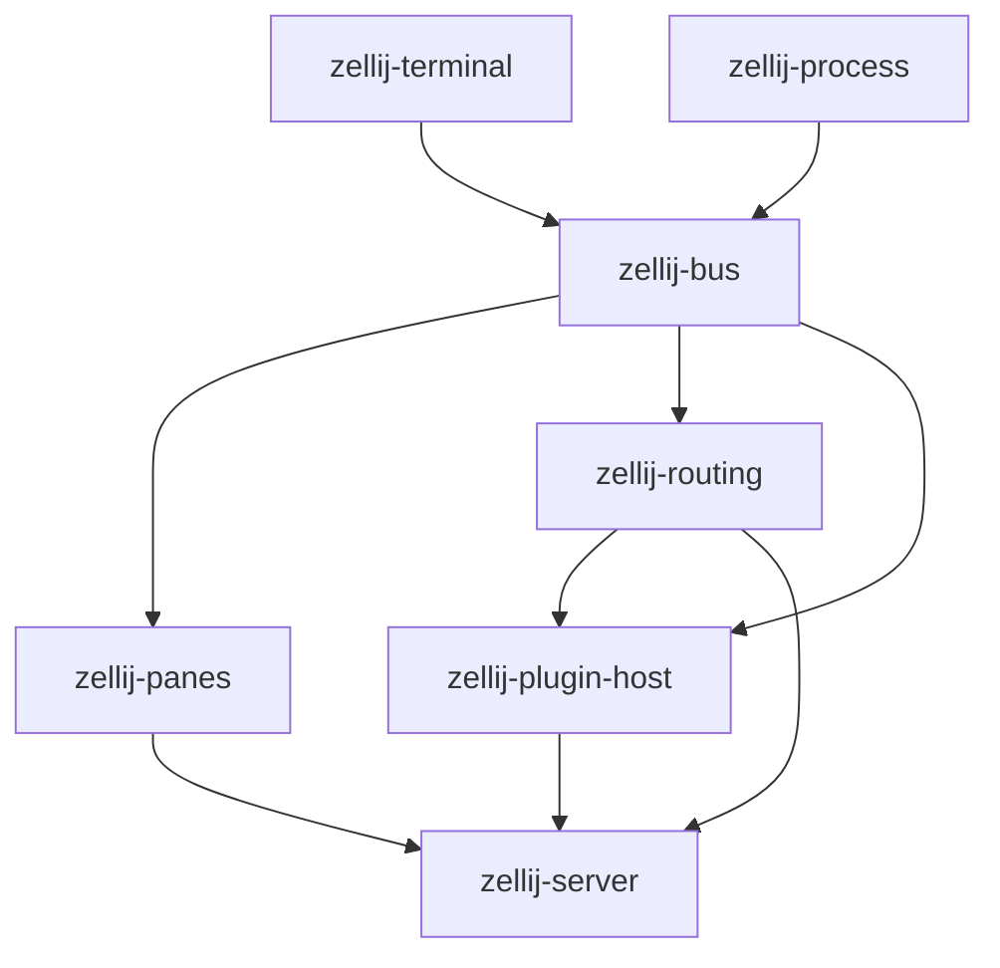

This document details the different components of the code base in plain English. The intention is to provide a high level description rather than a more detailed drill-down of each internal mechanism.

## Shared libraries

Consumers import shared code from its owning crate. The workspace has fourteen shared libraries:

| Crate | Ownership | Allowed Zellij dependencies |
|---|---|---|
| `zellij-types` | Shared models, identities, units, geometry, actions, options, layouts, manifests, plugin commands and events | None |
| `zellij-runtime` | Errors, channels, logging, paths, environment access, host identity, downloads, checkpoint locks, agent launch support | Types |
| `zellij-storage` | Recording storage and plugin-data engines for SQLite and Postgres | Types, Runtime |
| `zellij-config` | Config and layout loading, KDL/Lua parsing, precedence, overlays, themes, plugin resolution, permissions, embedded assets | Types, Runtime |
| `zellij-plugin-api` | Plugin protobuf schemas, generated code, conversions, protocol validation, authoring helpers | Types, Runtime |
| `zellij-ipc` | Client/server and nested-session protocols, framing, sockets, connection retries | Types, Runtime, Plugin API |
| `zellij-session` | Discovery, lifecycle, resurrection, session metadata and layout serialization, warped tabs | Types, Runtime, Config, IPC |
| `zellij-cli` | Clap arguments, completions, setup, CLI option merging, action conversion, session listings and diagnostics | All preceding libraries |
| `zellij-terminal` | Grid and rows, terminal characters, selection, hyperlinks, Sixel and Kitty graphics, output serialization, host queries, damage geometry | Types, Runtime, IPC |
| `zellij-process` | Pane supervisors, local and remote protocols, SSH transport, the broker, the Firecracker provider | Types, Runtime, Config, IPC, Session |
| `zellij-bus` | The server's thread bus: `ThreadSenders`/`Bus`, the six instruction enums and their payload types, `ServerOsApi`, warps, background jobs, the session recorder and layout metadata | Types, Runtime, Storage, Config, IPC, Session, Terminal, Process |
| `zellij-routing` | Synchronous action dispatch, dispatch helpers and completion waits | Bus, Types, Runtime, IPC |
| `zellij-panes` | The `Pane` trait, `TerminalPane` and `PluginPane`, the tiled, floating and overlay pane managers, frames and boundaries, `Tab` and its layout applier, pane groups | Types, Runtime, Config, IPC, Terminal, Bus, Tile Utils |
| `zellij-plugin-host` | The plugin host: wasm and Lua plugin loading, the plugin thread, host functions, pipes, job queues, workers, the plugin log pipe, plugin authoring helpers | Types, Runtime, Storage, Config, Plugin API, IPC, Session, Process, Bus, Routing, Tile, Tile Markdown |

These lists permit dependencies. They do not require every listed dependency.
`cargo x ci check` enforces them for normal, optional, target-specific, build, and development dependencies.
The root binary dispatches commands that start the client or server. The CLI library does not depend on these applications.

Models keep pure operations. Parser-owned free functions read or serialize KDL and Lua.
`CliAssets` contains serializable input fields. `zellij_config::cli_assets::load_config_and_layout` loads their configuration.
Config loading receives explicit paths and options. Clap arguments and CLI-specific merging stay in CLI.

`zellij-types::pane_size` owns pane dimensions, offsets, insets, and viewports.
`zellij-types::geometry` owns directions, resizing, split sizes, percentages, and floating-pane coordinates.
`zellij-types::agent` owns agent records, hook payloads, and pure hook interpretation.
Runtime owns tracing, watchdogs, and launch support. Process execution stays in the host crates.

`zellij-types::diagnostics::ErrorContext` holds the serializable six-entry instruction stack.
Its `add_call` method changes only that value. Runtime's `errors::add_call` also publishes the result to the current task or thread.
Use `errors::update_thread_ctx` to publish a received context. Use `errors::format_context` to format a diagnostic.
Runtime key interpretation receives a binding predicate, so runtime does not depend on configuration parsing.

The checkpoint reader retains its lock while configuration loading reads layout and pane-content files.
Runtime tests cover publication and lock behavior. Parser and session tests cover content loading under that lock.

Plugin protobuf sources and generated code live in `zellij-plugin-api/src` and `zellij-plugin-api/assets`.
Client/server and nested-session protobufs live in `zellij-ipc/src` and `zellij-ipc/assets`.
Use `cargo x proto` to regenerate all protocols. Generated fields retain their existing wire numbers.
Builtin WASM plugins remain under the workspace's `target/wasm32-wasip1/{debug,release}` directories.

Run focused tests with `cargo x test -p <owning-crate>`.
Run `cargo x postgres-test --build` followed by `cargo x postgres-test --test` for storage against Postgres.
Run `cargo x ci check` before a branch or PR handoff.

## Plugin runtimes

The server supports Wasm, Lua, and embedded Deno Core. They share permission checks,
host command dispatch, subscriptions, and the plugin render path.
Deno isolates stay in an executor-thread-local registry. The shared plugin map holds
only their handles and environments. Each invocation temporarily moves its environment
into scoped op state; no host operation keeps an environment borrow across an await.
Generation IDs reject completions from replaced isolates. Separate plugin and client
cancellation tokens stop execution without cancelling another client's instance.
See [JavaScript and TypeScript plugins](DENO_PLUGINS.md) for the SDK and offline checker.

## Data access

The server constructs one host-only `DataAccess` provider and shares it with the plugin runtime
and session recorder. Plugin data and recordings use backend-neutral synchronous interfaces
(`zellij-storage/src/data_access.rs`), and `DataAccess::from_backends` takes one backend for each.

Plugin data has two real backends. SQLite is the default: one `plugin-data.db` in the data dir.
Setting `plugin_data_url` to a `postgres://` URL (config file only, never the CLI or the client
socket — it may carry a password) points the store at that database instead, in the schema
named by `plugin_data_schema`, so every machine using it sees the same rows. Recordings stay in
SQLite either way; `DataAccess::postgres` is the pairing.

The two backends share one SQL engine (`zellij-storage/src/plugin_data_store/`): the predicate
compiler, query builders, migrations and registry are written once against an `Executor`, and a
`Dialect` names what the engines spell differently — placeholders, column types, `LIKE` versus
`ILIKE`, and the full-text index (FTS5 with triggers on SQLite, a generated `tsvector` column
with a GIN index on Postgres). Where the engines' defaults disagree — text collation, null
ordering, NUL bytes in text — the store picks one behaviour and enforces it on both, and the
store's test suite runs against both (`cargo x postgres-test`). CLI recording commands construct
the default SQLite provider at their entrypoint.

### Sharing a store between servers

The store has never been per-session: one `plugin-data.db` serves every zellij server on the
machine, and a Postgres one serves every machine pointed at it. Two things follow, and both are
in the data rather than in the engine.

**Rows about a running server say which one.** A pane id means nothing outside the server that
handed it out, and a session name is unique only within a machine — two machines can each run a
session called `main`. So the entities that are about a live server (`agent_latch`,
`agent_summary`, `agent_run`, `job`) carry a `host_id` beside `zellij_session_name`, and
`hocus_proto::agents::rows::Owner` is the pair. The id is resolved once at server startup by
`zellij_runtime::host_identity`: `ZELLIJ_HOST_ID`, then the `host_id` config option, then
`<data dir>/host-id`, then a newly minted uuid written there. It identifies a *data dir on a
machine*, which is the granularity that matters — two servers sharing a data dir share the pane
ids and session names it qualifies. Plugins read it off `PluginIds` beside the hostname, which
stays the label to show rather than the key to store.

The same reasoning reaches ids and reads, not just columns. A uid built from a pane id needs the
machine in it — `rows::pane_uid` does this, and so does the fallback shape of `agents::run_id`,
which would otherwise let two servers mint one name for two agents' timelines and interleave
them under an unguarded put. And a read that narrows to a *folder* has to narrow to a machine
too: `/home/me/work` on a build box is not this project, so `run_history::matches_root` takes
the row's `host_id` beside the run's ssh `host`, and `run_history::RootScope` pairs the root with
the machine so a caller cannot ask for one without the other.

**An empty `host_id` is a row from before the column, and what to do with one differs.** The
store migrates an entity unasked, and adding the column was an `ALTER TABLE ADD COLUMN ... NOT
NULL DEFAULT ''`, so every row already stored came out naming no machine. There was only one
machine then, so `""` reads as "this one" — but only where adopting the row is the right answer.
An `agent_run` is history: `rows::owned_or_unclaimed` accepts it on the read and on the guarded
close, and `rows::claim_unowned_runs` stamps the machine on so the run's next ordinary write
narrows the row. `run_history::Filter::pred` accepts it too, but only when the filter names a
session as well — paired that way it is the same bargain `owned_or_unclaimed` makes, while a
question about one machine alone cannot be answered by a row naming none. An `import_marker`
adopts it on the read and stops there: `store::import_recorded` writes this machine's own marker
but **never deletes the legacy row**. A bare `''` names no machine, so reading one is no evidence
that this machine wrote it, and deleting it takes away another machine's only record that it has
already imported — after which that machine reads its whole legacy archive in a second time, with
nothing to dedupe the result. The cost of keeping it is milder and is accepted: a machine that
joins a store already carrying a pre-host marker is told the import is done and will not read its
own files, which is what tolerating the row means in the first place. An `agent_latch` or
`agent_summary` is the opposite:
it names a pane in a server that is gone, so `rows::stale_unowned_delete_mutations` deletes it
rather than adopting it, and `rows::owned_by` stays strict. A `job` is left alone entirely —
firing a dead server's prompts at whoever upgrades first is worse than dropping them.

**Writes can say what they expected to find.** Every row carries a `rev`, which the store
advances on every write that touches it, and a `Put` or `Update` may name the `rev` it expects —
a compare-and-set, refused with `DataError::Conflict` and rolling the whole batch back. Used
where a write replaces something composed from an earlier read (a todo's text, a note's body),
and not for independent flag writes such as note archiving. Todo completion also depends on
the tree, so it uses the snapshot assertion described below.
`ApplyReport.per_mutation` reports rows affected per mutation, for callers guarding by hand.

**The `rev` has to be the one the value's author read.** A writer that fetches the row, builds
the new value and guards on the `rev` it just fetched has guarded a window microseconds wide:
the row already carries the other writer's revision, so the write that should be refused lands.
The revision worth guarding on is the one whoever composed the value was looking at, which for a
model is several turns back — so it travels outward in what the reader is shown and back inward
as an argument. `todos::items_json` and `notes::note_json` emit it, `todo_edit` and `note_edit`
take it as `expect_rev`, and `store::guarded_rev` prefers it to the row's own. `note_edit`'s
reaches the tags as well as the text: a tag set is replaced whole, so it is composed from a
reading like any wording, and `notes::plan_set_tags` adds a guarded update of the note itself to
a batch that would otherwise touch only the tag rows. One call that edits both guards once —
two guarded updates of a row in one batch is the second finding the revision the first bumped. A caller that
supplies none falls back to the fresh read, which is the old behaviour and nearly no guard at
all. Note that a fetch naming its columns loses the ones the store adds unasked, `rev` among
them, so a projection can silently turn a guarded write into an unguarded one —
`notes::LIST_COLUMNS` names `rev` for that reason.

**Todo topology and completion use a project snapshot.** Add, move, delete, completion,
undo, and each legacy import level
prepend `Mutation::AssertRows`, comparing the complete matching set of `(id, rev)` pairs in
the batch transaction. Any insertion, removal, or edit since validation refuses the entire
batch with `Conflict`; callers reload and decide again. The assertion writes no rows, returns
no IDs, and contributes zero to `per_mutation`. A move also keeps the source author's
`expect_rev`. Legacy children require their mapped parents to remain in the project.
SQLite's `BEGIN IMMEDIATE` protects the comparison through commit. PostgreSQL takes
`SHARE ROW EXCLUSIVE` locks on every table touched by a guarded batch, in stable table order,
before checking any assertion. Ordinary writers are blocked too. This briefly serializes
writes across projects in those tables, and unrelated edits within a project can conflict.
Agreeing completion writes also advance revisions and can invalidate a pending plan.

**Note links guard their target todos.** Link and attachment plans assert the `(id, rev)`
pairs for the requested todo IDs, in chunks, before writing tags or links. Missing targets fail
validation. Target edits or deletions before commit cause a conflict and roll back the batch.
`note_add` checks targets before creating the note, then checks again after receiving its ID.
If attachment planning or application fails, the note remains and the reply includes a warning.
Both frontends report snapshot conflicts as “the todo list changed; reload and retry” without
an automatic retry.

**What is not handled:** a watch is only re-evaluated by writes made in the same server process
(`refresh_watches` has one caller, in the local apply path), so on a shared Postgres another
machine's write does not wake a watcher here. There is no change feed and no polling fallback.
Recordings are likewise untouched: they stay in SQLite, are written by one owning thread, and
their `recording_sessions` rows are keyed by a bare local rowid with no host column — that would
need one before any Postgres backend for them.

## Screen (zellij-server/src/screen/)
The Screen is responsible for managing the relationship between the panes currently displayed on screen.
It is in charge of actions such as: 
  * Coordinating the resizing of panes
  * Creating new panes
  * Closing existing panes (and filling up their space by other panes)

### When a tab has nothing left in it

`Screen::settle_tabs` (`screen/tabs.rs`) runs after every screen instruction. Rendering does
not decide tab lifetime. A usable destination has finished its layout and has a selectable
pane. Pending tabs and arrangement destinations wait for their panes. Deferred tab switches
store stable tab IDs and resolve display positions when applied.

An empty tab closes into a usable destination. A hidden-only tab with a live terminal keeps
its ID and panes when another usable tab exists. If no destination is usable, settlement waits
for pending layouts. Without pending layouts, the session ends unless a plugin guards quit or
a hidden terminal still runs. In those cases, settlement requests a default replacement tab.
With no attached client, that request waits for attachment.

The emptied tabs remain until a destination becomes usable. If the replacement becomes usable
first, their clients and hidden work move there. Guarding plugins also survive, including tiled,
floating, suppressed, and overlay plugins. Their quit notices remain registered. Settlement then
raises the quit confirmation. If another tab becomes usable first, settlement uses it and cancels
the obsolete confirmation request.

Replacement identity remains after layout loading and confirmation. A replacement terminal that
exits naturally becomes a held pane that can be rerun. Buffered exits follow the same rule.
Explicitly closing that pane can request another replacement and confirmation. A replacement
layout with no selectable pane ends the session instead of starting a spawn loop.

Focused-tab, tab-ID, and tab-position close actions share a preflight. A guarded last-tab request
asks for confirmation before destruction. Hidden live terminals get a usable destination before
their tab closes. Internal teardown does not repeat this preflight. A failed PTY shutdown send
does not interrupt client relocation or tab renumbering. Settlement errors are non-fatal at the
instruction boundary. Plugin destruction removes quit notices synchronously. Runtime unload
notifications provide eventual cleanup.

## Terminal emulation (zellij-terminal/)

`zellij-terminal` owns the grid and rows, terminal characters, selection and search, hyperlinks, ANSI helpers, Sixel, and Kitty graphics.
It also owns output serialization, host-query types, component parsing, and damage geometry.
`PaneId` lives in `zellij-types::pane_id`, with `TerminalId` and `PluginId` payloads,
and is re-exported here. Host code and the plugin SDK use that same enum. The shared internal IDs
(`TerminalId(u32)`, `PluginId(u32)`, and `ClientId(u16)`) live in `zellij-types::internal_ids`
and are re-exported by the consuming crates. The server retains its existing re-export paths.
The pane enum preserves its JSON variants and protobuf values. Other public plugin IDs,
IPC, supervisor messages, and persistence records still keep primitive numbers;
internal code wraps incoming IDs and unwraps them when constructing boundary payloads.
Neither `zellij-terminal` nor `zellij-process` depends on the server or on the other extracted crate.

`TerminalPane`, `PluginPane`, pane managers, frames and tabs are `zellij-panes`; plugin hosting is
`zellij-plugin-host`; screen coordination, the pty thread and the server thread remain in
`zellij-server`. The terminal crate parses and renders terminal state. The server coordinates
panes, clients, plugins, and threads.

## The thread bus (zellij-bus/)

Every server thread owns one instruction enum (`ScreenInstruction`, `PtyInstruction`,
`PluginInstruction`, `BackgroundJob`, `PtyWriteInstruction`, `ServerInstruction`) and sends the
others' through `ThreadSenders`. `zellij-bus` holds those enums, the payload types they carry
(`NotificationEnd`, `SessionLayoutMetadata`, `PluginRenderAsset`, the spawn and adoption records,
`LoadingIndication`, `FrameColorOverride`), `Bus` itself, and the code that only ever talks over
it: warps, background jobs, the session recorder, and
the `ServerOsApi` trait with its Unix implementation. Its rule of admission is that nothing in it
names a tab, a pane, a screen, or the plugin runtime; a type that needs one of those belongs above
the bus. The server keeps every old path as a re-export (`zellij_server::os_input_output`,
`zellij_server::background_jobs`, `crate::thread_bus`, ...), so consumers did not change.

## Action dispatch (zellij-routing/)

`zellij-routing` owns `route_action`, its dispatch helpers and synchronous completion waits.
The server and plugin host call it; bus and panes never depend on it. Dispatcher edits therefore
rebuild routing and its host/server consumers without rebuilding bus or panes.
`NotificationEnd` and `ActionCompletionResult` remain at `zellij_bus::route`, since instruction
payloads carry them. The server's `crate::route` re-exports both the dispatcher and payloads.

`route_thread_main`, the per-client router that reads a client's socket and calls `route_action`,
stays in the server (`zellij-server/src/client_router.rs`) because it holds `SessionMetaData`.

## The plugin host (zellij-plugin-host/)

`zellij-plugin-host` runs the plugin thread: it loads wasm modules and Lua scripts, keeps the
plugin map, runs plugins on the pinned executor, answers their host functions
(`zellij_exports.rs`), owns the `queues` job state machine, and turns every `PluginCommand` into
an instruction for another thread.
It depends on `zellij-bus` and `zellij-routing`: it never names a tab, a pane, or the screen,
and everything it asks of them goes out as a `ScreenInstruction`, `PtyInstruction` or
`Action` through `route_action`. The server keeps the old `crate::plugins::…` paths as an alias
of the crate, plus `check_lua_plugin`, `get_engine` and `plugin_authoring` at its root.
`PluginPane`, the pane that displays a plugin, stays with the other panes; its only tie to the
host is the `PluginInstruction::Update` it sends.

## The pane stack (zellij-panes/)

`zellij-panes` is everything under a tab: the `Pane` trait, `TerminalPane` and `PluginPane`, the
tiled, floating and overlay pane managers, frames, boundaries, notifications and context-menu
layout under `ui/`, `Tab` itself with its layout applier, swap layouts and mouse handler, and pane
groups. It sits on `zellij-bus` and never names the screen; a tab reaches the other threads
through the `ThreadSenders` it is given. The screen, which owns the tabs, stays in
`zellij-server`, and the server re-exports `panes` and `tab` at its root so external paths such
as `zellij_server::panes::TerminalPane` and `zellij_server::tab::Pane` are unchanged. The
`test-support` feature exposes the handful of test helpers on `Tab`, `CopyOptions` and
`ContextMenuLayout` that the server's screen tests drive. The server's normal dependency enables
it consistently for build, run, integration tests, unit tests and lint. The helpers also compile
in release builds, but production code does not invoke them. Their existing feature guards remain.

Layering (arrows point from dependency to consumer):

## Terminal Pane (zellij-panes/src/panes/terminal_pane.rs)
The TerminalPane represents a pane on screen that connects to a single pty (pseudo terminal) and (presumably) has one shell or other program running inside it.
The TerminalPane has two main roles:
  * Keeping track of the Scroll, which represents the buffer of lines in this terminal
  * Interpreting the ANSI/VT instructions coming from the pty in order to adjust the styling of characters, change the cursor position, etc.

### Scroll (zellij-panes/src/panes/terminal_pane.rs and zellij-terminal/src/panes/grid.rs)
The Scroll holds the terminal buffer and is in charge of:
  * Keeping track of the viewport (which part of it we see) this can change when we scroll up/down
  * Keeping track of the cursor position
  * Controlling line-wrapping

### Terminal Character (zellij-terminal/src/panes/terminal_character.rs)
The `TerminalCharacter` represents a single character in the pane. It holds the char itself on the one hand, and an internal `CharacterStyles` struct representing the styling of this character.
This struct derives the `Copy` trait for performance reasons, because it is moved around quite a bit (eg. when line wrapping).

### How a terminal emulator draws characters?
The ANSI/VT instructions received from the pty include style instructions (eg. change foreground colour to red) as well as instructions to reposition the cursor (eg. go to line x/y) and to perform certain actions with the current buffer on-screen (eg. delete all lines after cursor).

When an instruction is received to change the character style, we know that all characters printed from now on should use that style. This is true until we move to a new line (with a newline instruction or a go to instruction) or until we receive a style reset code for this specific style. There are several kinds of reset codes that apply to different styles.

It's important to understand that these styles are ongoing relative to the current cursor position. It might be useful to imagine them as brushes: "pick up the red brush", "put down the bold brush", etc.

This is important to note because the styles themselves are saved only on characters that have already been printed. If we receive an instruction to change the style to blue, then print a (blue) character, then receive another instruction to move to a new line, print another (plain) character and then come back, the style would be reset. We would have to receive a new instruction to change the style to blue in order for the next character to be blue.

## Boundaries (zellij-panes/src/ui/boundaries.rs)
The Boundaries refer to those lines that are drawn between terminal panes. A few things that happen here:
  * The Rect trait is here so that different panes can implement it, giving boundaries a generic way to calculate the size of the pane and draw boundaries around it.
  * Here we use the [unicode box drawing characters](https://en.wikipedia.org/wiki/Box-drawing_character) in order to draw the borders. There's some logic here about combining them together for all possible combinations of pane locations.

## Animation (zellij-types/src/animation.rs, zellij-terminal/src/ui/damage.rs)
Anything on screen that moves over time — toast notifications sliding in and out, the bell flash easing off a pane frame, the plugin loading dots — is built from the same two pieces.

`zellij-types/src/animation.rs` holds the pure part: an `Easing` curve, a `Tween` carrying one scalar from where it is to where it is going, and `blend` for interpolating a `PaletteColor`. The rule that makes it work is that **nothing in it reads the clock** — `now` is always a parameter. One frame therefore samples every live animation at a single instant, and a test drives an animation by handing in fabricated `Instant`s rather than by sleeping.

The frames themselves come from one shared clock: `BackgroundJob::StartAnimationClock` runs a `tokio::time::interval` that sends `ScreenInstruction::AnimationTick`. That tick advances *nothing*. It only asks for a render, and `Screen::render_to_clients` samples everything at the instant it composites. This is what makes the result frame-rate independent: a tick that arrives late, twice, or not at all costs a frame and never a position, so an animation always takes the wall-clock time it promised even when the screen thread is busy or renders are being held back.

`Screen::animation_clock_period` is the one place that decides what the clock does, derived from the animated state rather than from a registration list, so the clock cannot get stuck running over an idle session. It answers with a period rather than a yes/no, because the surfaces differ: continuous motion — a toast sliding, a bell fading — needs `FRAME_PERIOD` (~60fps), while the plugin loading dots are a four-character "still working" pulse that only changes every `DOT_PERIOD` (500ms). Holding the clock at 60fps for the dots would run the whole `render_to_clients` path sixty times a second for as long as any plugin is loading, which for a plugin that never finishes is forever. The aggregate is computed on the screen rather than requested by each surface so that a plugin load starting mid-slide cannot slow the clock underneath a moving toast.

Every tick asks for a frame, *including* the one that finds everything settled. That last frame is the one that actually paints the settled state: renders are debounced by `REPAINT_DELAY_MS`, so the frame a still-animating tick asks for is composited up to that long before the deadline it was aiming at. Without one more tick past the deadline, a dismissing toast would be left painted a sliver short of gone — and never reaped, since `reap_settled_notifications` only runs inside a frame — until unrelated output happened to repaint.

Anything drawn *over* a pane — currently just toasts — needs one more thing. A pane only emits cells its own grid thinks are dirty, so the moment a moving overlay stops covering a cell, that cell keeps whatever the overlay last drew there. `zellij-terminal/src/ui/damage.rs` diffs what the overlay painted last frame against what it is painting now, and `render_to_clients` repairs the difference *before* the panes render, narrowed to the panes actually overlapping it. An overlay that is only growing produces no damage at all, so arriving is free and only leaving costs repaints.

## Process ownership (zellij-process/)

`zellij-process` owns pane supervisors, local and remote protocols, SSH transport, the broker, and the Firecracker provider.
It also defines `AsyncReader` and the command-resolution helpers. It depends on shared utilities, not on the server.
Supervisor exit callbacks carry a `TerminalId`. The server converts it to `PaneId::Terminal` before calling its existing callback.
The server retains OS implementations, PTY scheduling, session coordination, and its existing public module paths through re-exports.
The `zellij-firecracker` binary calls the process crate directly.

## PTY Bus (zellij-server/src/pty.rs)
The PtyBus keeps track of several asynchronous streams that read from pty sockets (eg. /dev/pts/999), parse those bytes into ANSI/VT events and send them on to the Screen so that they can be received in the relevant TerminalPane.

A pane on another machine is spawned off the pty thread. Its `RunCommand` carries a `PaneTarget` (`Local`, `Ssh { host }` or `Firecracker { vm, image, worktree }`), and any spawn, layout, layout override or re-run whose command `defers_spawn()` — a remote target that is not held on start — goes to a worker thread as one `SpawnJob`. The worker asks the OS layer to `resolve_spawn` (an ssh host is used as is; a Firecracker VM is booted, or found, by the provider and its ssh endpoint returned as a `RemoteEndpoint`, separate from the target the pane shows) and then `spawn_resolved` (open the pane on the broker and register its transport), and sends one `PtyInstruction::SpawnResolved` back with the readers. The pty thread finishes the job exactly as it would a local spawn, so a VM that takes a minute to boot or a host that is slow to answer never stalls another pane's input. A layout's results keep one slot per run instruction so they line up with the layout when it is applied; a layout that cannot be applied past some slot closes the remote panes already started for the slots after it. Re-runs of one pane are serialised through a per-pane `RerunState`: a rerun asked for while one is off-thread queues behind it, whatever its target, so two commands never stream into one pane, and a result landing on a pane closed meanwhile is torn down through `clear_terminal_id`.

## Pane supervisors (zellij-process/src/pty_host/)
Each pane's process is owned by a small supervisor process ("pty-host") rather than by zellij-server. The supervisor calls `openpty`, forks the pane's command, and hands the server a dup of the pty *master* over `SCM_RIGHTS`. Everything downstream of that descriptor — the async reader, window-size ioctls, backpressure on writes — works exactly as it did when the server owned the pty.

What the split buys is lifetime. The child belongs to the supervisor, so a server that exits or is killed does not take its panes with it. The supervisor reads a closed control channel as "detached" rather than "shut down" and starts draining the pty into a bounded ring buffer, so the child never blocks on a full buffer. Only an explicit `Terminate` ends a supervisor.

Because a detached supervisor is still holding a live pane, it can be picked back up. It binds a named socket, and an `Attach` on that socket re-keys it to the attaching server's pane, hands the master over again, and replays whatever the ring caught in the meantime. Two things are built on that one primitive:

  * `zellij action warp-pane --to-session <name>` moves a pane between sessions. The source releases the supervisor without killing it, serializes the pane's screen, scrollback and agent record, and sends the other session an `AdoptPane`; the target attaches and replays them into a new pane. The agent's *history* is not in that payload and does not need to be: it lives in `agent_run` rows in the plugin data store, which is not per session — one file per machine, or one Postgres shared between machines — so what has to travel is the run's id rather than the run. That rides on the record, as `AgentInfo.run_id` — see `docs/AGENT_HOOKS.md`. The losing session closes the run under a predicate naming itself as its owner — the machine and the session both, since a session name alone would match another machine's session of that name — and the gaining session reopens it by id, so whichever write lands second the entries survive. Nothing else about the process changes — same pid, same working directory, same open files. A local child inherits its supervisor id as `ZELLIJ_PANE_REF`; because `Attach` re-keys the supervisor's current session and terminal id, an implicit `agent-report` can resolve that stable id after the move instead of using the stale per-session values in the child's environment.
  * `zellij action warp-tab --to-session <name>` moves a whole tab the same way, releasing every supervisor in it and sending an `AdoptTab`. Use `--tab-id <id>` to select a tab by its stable ID; `warp-tab --from-session <name>` requires this flag. What travels alongside the panes is a *layout* and each pane's agent record — run id and all, so each pane's history is picked up the same way — rather than their pane sizes, reconstructed from their geometry by the same code session resurrection uses — so the tab re-flows to fit a session whose terminal is a different size instead of arriving clipped. The tab's plugin panes are the one thing that does not survive intact: they have no process to hand over, so they ride along as `Run::Plugin` nodes and the receiving session starts them afresh in the same slots. The tab's name travels with whether the user gave it in the session it left (`WarpedTab.user_named`); only a name the user gave holds off the project name the receiving session would otherwise show (`Screen::plugin_tab_names`), and a name the tab was merely born with — "Tab #3", a layout's — is a fallback there as it was here. A pane's title rides as its layout name only when the user or its program set it; a default like "Pane #3" rides as `WarpedPane.caption` and is applied with `set_title`, so it stays a default and is never lent to the tab over the project.
  * `zellij pty-host adopt <id>` does the same thing with no source session at all, which is how a pane that outlived a crashed server gets back on screen.

Pane warp accepts visible panes only. Selecting a stack-list member moves the entire list, including hidden editors and their subjects. Replacement chains retain their closing behavior at the destination. Terminal processes continue, and plugin instances restart from their launch configuration. Tab warp also carries parked terminals and preserves floating visibility. Independent session overlays and background plugins stay local.

Both transfer paths use references local to the payload to reconstruct hidden relationships after destination IDs are assigned. The destination advertises companion support in its liveness reply. An older destination cannot receive a group, and the source refuses that transfer before releasing any process.

The controlling option is `detachable_panes`. With it off, panes are spawned in-process as before and neither operation is available.

A **remote pane** warps too, by the same shape but not the same primitive: its supervisor is on the far machine, behind the broker, so there is no local socket to attach to. What the broker offers instead is already there for reconnects — panes live in a registry keyed by a token, independent of any connection, and `Resume { pane_token, received }` re-attaches to one with a byte-exact replay. A warp is that same resume with a *different server* on the other end, each having built its own ssh forward. So the pane's address travels as `{host, pane_token, received}` (plus its `RunCommand`, which a resume does not carry and an `AttachAck` would have) in place of the supervisor socket, and the adopting session resumes through its own forward.

The one thing that had to be added is `Release`. The broker frees a pane when the old connection's blocking read returns, which is not a moment the releasing side can name — the adopting session's `Resume` races it and is refused as a double attach. `Release` makes the detach happen before the acknowledgement, exactly as `ServerToHostMsg::Release` does for a local supervisor, so the token can be handed over the instant the release returns. Recovering a remote pane stranded by a failed handoff is `zellij pty-host list --host <machine>` and `zellij pty-host adopt --host <machine> <token>`: the token only ever existed in the releasing server's memory and the broker's registry, so the broker is the only thing that can still answer.

A **Firecracker pane** is a remote pane whose SSH endpoint comes from a configured provider.
Zellij keeps the VM name, image, and host worktree on `RunCommand`. It calls the provider's
idempotent `ensure` operation for each launch. It then feeds the returned endpoint into the remote
broker path. A canonical host worktree identifies a VM. Sessions hold leases on that VM, and the
provider stops it after the last lease ends. See [`FIRECRACKER.md`](FIRECRACKER.md) for the
provider contract and lifecycle.
