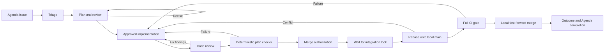

# Local issue lifecycle

Yinz uses Agenda for issue descriptions, Swamp for durable development state,
and Git worktrees for local implementation and merging. Agent work runs in
visible Yinz panes through the reusable `@yinz/agent` behavior. The workflow
follows Swamp's reviewed-plan and evidence model while replacing its Swamp Club
issue and GitHub PR stages with Agenda and local Git.



## Ownership

| Record                         | Owner            | Purpose                                                         |
| ------------------------------ | ---------------- | --------------------------------------------------------------- |
| Workspace and item ID          | Agenda           | Stable issue identity.                                          |
| Item title and note            | Agenda           | Problem, requirements and acceptance criteria.                  |
| Plan, review and authorization | Swamp            | Versioned evidence for proceeding.                              |
| Agent task and submission      | Swamp and Yinz   | Visible worker, provider conversation and exact prompt outcome. |
| State and events               | Swamp            | Resume point and history across sessions.                       |
| Source branch and worktree     | Git              | Implementation and its isolated build artifacts.                |
| Gate and merge receipt         | Swamp and Git    | What was checked and which local commit landed.                 |
| Delivered outcome              | Agenda and Swamp | Whether the issue was resolved.                                 |

Use an existing Agenda task or capture a new one with a concise title and a note
describing the problem, acceptance criteria and useful reproduction details.
Search before creating a duplicate. Reuse project categories where useful, using
their returned IDs. Lifecycle automation does not depend on fixed category IDs.

## One control checkout

Run lifecycle commands against one canonical checkout containing `.swamp.yaml`,
the behavior implementation and workflow definitions. Issue worktrees contain
the code being changed; the control checkout holds the authoritative Swamp data.
Using a separate Swamp store in each worktree would split issue history and
per-issue locking.

The launcher [scripts/issue-lifecycle](../scripts/issue-lifecycle) selects the
checkout containing itself by default. Invoke that copy by absolute path when
working elsewhere, or use `--control` to name the control checkout explicitly.
It passes the same repository to every Swamp command. It computes the behavior
identity from the workspace and item ID, hashing long workspace names to stay
within Swamp's 64-character name limit. Use the launcher instead of constructing
behavior names yourself.

Invoke `start` from the Git worktree where all lifecycle workers should run;
subdirectories are supported. The launcher passes that root through
`yinz-issue-start`, and the lifecycle records its canonical `workerWorktree`.
Direct workflow calls must supply `workerWorktree` too. Before saving any state,
`start` claims that worktree for the issue in the repository's ownership registry
(`yinz-lifecycle/worktree-owners.json` in the common Git directory). It refuses a
worktree on `main`, a detached HEAD, and a worktree or branch claimed by another
issue. A claim stays pending until `start` saves the issue's state, then
becomes permanent, so each worktree serves one issue. A pending claim means
that issue's `start` ended without saving state: another issue's `start`
reclaims it when that issue is not running, and refuses while its `start` is
still in progress. A retried `start` for the same issue replaces its own
pending claim elsewhere. Repeated `start` returns existing state unchanged and
confirms the claim if it was left pending. Later commands may run from another checkout without
changing the saved worker directory. Swamp commands and storage still use the
canonical control checkout.

The examples use these shell variables:

```sh
LIFECYCLE_REPO=/absolute/path/to/the/control-checkout
AGENDA_WORKSPACE=your-existing-workspace
AGENDA_ITEM_ID=123
```

Replace the example workspace and item ID with values returned by Agenda. Store
the workspace once in the control checkout's Swamp vault:

```sh
printf '%s\n' "$AGENDA_WORKSPACE" | swamp vault put default AGENDA_WORKSPACE \
  --repo-dir "$LIFECYCLE_REPO" --json
```

The checked-in `default` vault definition uses local encryption. If the control
checkout has no vault definition, create it first with `swamp vault create
local_encryption default --repo-dir "$LIFECYCLE_REPO" --json`. Values and the
encryption key remain in ignored local Swamp storage; configure the value again
in a fresh clone. The workspace is an identifier, not a credential: it remains
visible in issue identity, state and events.

The launcher reads `default/AGENDA_WORKSPACE` for every operation. It does not
use Agenda's current selection or fall back when the vault value is missing or
invalid. `--workspace` is optional and only asserts that a supplied name matches
the vault. Lifecycle methods independently verify the setting before proceeding,
including direct workflow execution, and the Git integration helper checks it
before rebase and again before merging. Changing the configured workspace does
not migrate existing issues; restore the original setting to resume those issues.
After setup, the shell `AGENDA_WORKSPACE` variable is only for manual Agenda commands.

Keep `LIFECYCLE_REPO` unchanged when working in another checkout. The installed Swamp
binary loads the local `@yinz/issue-lifecycle` and `@yinz/agent` behaviors.
Python 3.11 or later, Agenda and Git must also be on `PATH`; verification
requires Yinz's normal build prerequisites. Agent tasks require the installed
`yinz` CLI, a running local Yinz session and the selected provider. Specify the
session explicitly; `YINZ_SESSION_NAME` alone does not select it.

Local `main` must be checked out in exactly one clean worktree. The issue branch
must be a different local branch in the same Git repository.

Read the issue before starting:

```sh
agenda --workspace "$AGENDA_WORKSPACE" --json info
agenda --workspace "$AGENDA_WORKSPACE" --json item show "$AGENDA_ITEM_ID"
```

Start from the intended feature worktree (create it first if needed; the main
checkout is refused), then inspect it:

```sh
"$LIFECYCLE_REPO/scripts/issue-lifecycle" \
  --item "$AGENDA_ITEM_ID" start
"$LIFECYCLE_REPO/scripts/issue-lifecycle" \
  --item "$AGENDA_ITEM_ID" status
```

Drive triage, planning and review to the plan-approval handoff with an input file:

```json
{ "agent": { "session": "your-running-session", "kind": "claude" } }
```

Replace the example session and provider with the intended ones. Pass the file
to `drive`:

```sh
"$LIFECYCLE_REPO/scripts/issue-lifecycle" \
  --item "$AGENDA_ITEM_ID" \
  drive --input-file /absolute/path/to/drive-settings.json
```

Keep evidence files issue-scoped so concurrent work cannot overwrite another
issue's inputs. Pass paths and text as arguments; do not interpolate issue
descriptions into shell programs. Run `scripts/issue-lifecycle --help` for the
launcher interface. For direct Swamp operations, inspect
`swamp help behavior
run` or `swamp help workflow run` and always supply
`--repo-dir` with the control checkout.

## Stages and evidence

The repository skill at
[`.agents/skills/issue-lifecycle/SKILL.md`](../.agents/skills/issue-lifecycle/SKILL.md)
drives the lifecycle. Use `drive` for ordinary start/resume flows and after
restart or rollback recovery. Each task runs in a visible Yinz pane and
returns a role-specific JSON object. Swamp validates that result against the
current issue, plan and commit before importing it as evidence. The controller
records human authorization and performs deterministic lifecycle operations; it
does not replace pane workers with headless agents or inline agent work.

`drive` runs in the foreground until it publishes a concrete handoff or blocker.
The controlling agent must wait for that command, collect the handoff and present
it before ending its turn. A yielded command, launched pane or workflow ID is
progress. Waking a controller after its turn or session ends is outside this
change. The launcher prints readable evidence on stderr and one handoff JSON
object on stdout. The behavior also logs the readable result and publishes the
`handoff` resource, including the issue snapshot, plan version or commit,
assignment identity, decision and supporting evidence.

The driver runs initial triage, planning and plan review automatically. The first
blocking review gets one automatic targeted revision and review. Its allowance and
complete assignment are reserved atomically before launch, once per requirements
generation. Resume, rollback, restart, manual planning and command reinvocation do
not replenish it. A refresh with genuinely changed requirements starts a new
generation with an initial plan and one automatic revision. Plan versions remain
monotonic across generations.

Remaining high/critical findings return `authorize_plan_revision` with the current
plan, original review, effective findings, history, revision responses and proposed
next version. Repeated `drive` calls reuse this handoff without launching workers.
The controller can inspect cited code and record supported dispositions without
asking the user:

```json
{
  "planVersion": 2,
  "reviewFingerprint": "<fingerprint from the current handoff>",
  "dispositions": [{
    "findingId": "caller-validation",
    "disposition": "rejected",
    "rationale": "The cited caller already validates input before dispatch.",
    "evidence": ["src/caller.rs:42-51 validates input before invoking dispatch"]
  }]
}
```

Pass this input to `adjudicate-plan`, then `drive` again. Dispositions are
`resolved`, `rejected`, or `downgraded`; downgrades require a lower corrected
`severity`. Each requires a rationale and nonempty evidence. Explain the source
inspection and judgment. An accepted unresolved high/critical risk remains blocked
for user direction; it cannot be marked resolved merely to advance. The original
review is preserved, and dispositions are stored separately, applicable only to
the matching plan and review fingerprint. Stale inputs and mutations while a
worker or saved reservation is unresolved are rejected. The fingerprint fences changed plans, reviews and requirements generations.
Rollback that retains the current review also retains its applicable dispositions;
removed or changed review evidence cannot use them.

To authorize one further targeted revision, pass this input to `drive`:

```json
{
  "revisionApproval": {
    "handoffId": "<id from the current authorize_plan_revision handoff>",
    "request": "<the user's exact instructions and authorization for this revision>"
  }
}
```

The authorization and complete planner assignment, including the exact user
request, are saved before dispatch. Resume reuses that assignment and reviews the
resulting version. Remaining blockers require supported adjudication or another
explicit authorization. Changed requirements, lifecycle state or assignments
invalidate old proposals. Blank requests and approvals for other handoff types
are rejected. Manual planning and explicit rollback/restart remain available but
do not restore the automatic allowance. Restart instructions reach the replacement
worker, and accumulated feedback survives subsequent revisions.

Optional `planningContext` records accumulated feedback, accepted decisions,
prior plans and reviews, revision summaries and adjudications. Historical evidence
is separate from the current review and never satisfies approval gates. New
revisions must summarize changes and respond to every blocking finding as
`addressed`, `disputed`, or `unresolved`, with rationale and evidence. Reviewers
receive the previous plan, findings, responses and current plan, verify fixes,
and check for new defects. Workers must read the skill's
[planning standards](../.agents/skills/issue-lifecycle/references/planning.md) and
[review standards](../.agents/skills/issue-lifecycle/references/review.md).
Plan and code reviewers also read the
[Yinz review dimensions](../.agents/skills/issue-lifecycle/references/dimensions.md)
for applicable repository rules and the existing-field finding citation convention.

Existing records need no rewrite: new fields are optional, and saved prompts and
snapshots are kept. Results are always validated against the current contract;
an in-flight assignment launched under an older prompt may need a restart. Legacy
plans beyond version one are treated as having used the allowance; legacy
first-version plans may receive one automatic revision. Already-recorded revision
authorizations remain usable.

A clear review returns `approve_plan`. Revision authorization does not approve
implementation: record that separate approval explicitly with `approve`.
The `prepare_worktree` handoff requires `implement` to adopt the recorded worker
worktree.
After preparation, `drive` runs implementation and code review, then runs the
plan's checks at the reviewed commit (see
[Deterministic verification](#deterministic-verification)). It returns
`authorize_merge` with the delivered change, review coverage and a checklist built
from that verification run. Code blockers or failed checks return `blocked` for
repair and fresh review. `ready`, `merge` and `summarize` remain explicit operator operations.
The driver never infers revision approval, implementation approval, merge
authorization or a CI waiver.

Resume with `drive` and no input: the selected session and provider settings and
current assignment are durable. Pending work resumes its original task and
submission; ordinary acknowledged wait timeouts keep observing it. Dialogs,
uncertain delivery, missing sessions, invalid evidence and provider failures
produce blockers without replacement submissions. Interrupted evidence imports
reconcile before new work is dispatched. Completed handoffs retain their identity
across resume; changed state or assignments invalidate them, including restarts
and rollbacks. A pending rollback must finish through `resume-rollback` first.
Single-role `agent` and `resume-agent` remain available for deliberate low-level
control and diagnostics, using their existing inputs.

| Launcher command                | Evidence and effect                                                                                                   |
| ------------------------------- | --------------------------------------------------------------------------------------------------------------------- |
| `start`                         | Read the Agenda issue, claim the invoking feature worktree, and record its identity, description and worktree through `yinz-issue-start`. |
| `drive`                         | Run missing workers or resume their original submissions through `yinz-issue-drive`, returning a human handoff or blocker. |
| `status`                        | Inspect the current state before deciding what to do next.                                                            |
| `refresh`                       | Re-read a changed Agenda description and invalidate planning evidence that no longer covers it.                       |
| `agent` with role `triage`      | Investigate the issue in a pane and import classification, acceptance criteria and reproduction evidence.             |
| `agent` with role `plan`        | Generate concrete steps, affected files, risks, test strategy and structured checks; revisions need fresh review.     |
| `agent` with role `review_plan` | Review the current plan against the code and import findings.                                                         |
| `approve`                       | Record the user's authorization for the reviewed plan.                                                                |
| `implement`                     | Adopt the recorded worker worktree (legacy issues may create one).                                                                    |
| `agent` with role `implement`   | Implement and commit the approved plan in the existing issue worktree, running focused checks.                        |
| `agent` with role `review_code` | Review the committed implementation and import plan conformance, deviations and advisory reviewer checks.             |
| `verify`                        | Run `yinz-issue-verify`: the plan's checks at the reviewed commit, recording exit codes, durations and logs.          |
| `resume-agent`                  | Retrieve the original submission or reconcile already-applied evidence; never resubmit or relaunch.                   |
| `rollback`                      | Explicitly return to any lifecycle step, archive the previous assignment and downstream decisions, and reopen Agenda. |
| `restart-agent`                 | Roll back to a worker step and dispatch a fresh assignment with the requested session and provider. |
| `resume-rollback`               | Finish an interrupted rollback and resume its saved replacement assignment, if any. |
| `discard-agent`                 | Discard unusable completed evidence, a confirmed stopped failure, or a resource-free rejected launch, with an operator reason and confirmation. |
| `ready`                         | Record authorization to integrate the reviewed change; requires passing verification of that commit.                  |
| `merge`                         | Run `yinz-issue-merge`; serialize rebase, full CI and local fast-forward merge, recording the result.                 |
| `repair`                        | Record repair work after an integration failure and return to development and review.                                 |
| `summarize`                     | Record the delivered outcome and complete the Agenda task only when merged and `outcomeMet` is true.                  |

Direct `triage`, `plan`, `review-plan` and `review-code` commands remain
low-level evidence methods; normal agent work uses the pane roles above. The
merge workflow calls the shared `yinz-main-merge` coordinator, which invokes the
issue behavior's `integrate` method. The coordinator and OS lock serve different
purposes: one orders Swamp integration execution; the other protects the shared
Git repository.

Descriptions and plans can evolve. Refresh the issue when requirements change;
revise the plan when the approach changes. A stale review does not cover a newer
plan or a repaired implementation. Record real findings and command results;
adopting already-written code does not excuse its review.

Approval already given in the current session remains valid within its stated
scope. The operator records that authorization rather than asking repeatedly. If
plan or merge authorization is absent, present the concrete work and request the
missing decision. Approval to implement does not itself authorize merging.

## Pane tasks

The launcher captures the invoking control agent's `YINZ_SESSION_NAME` and
`YINZ_PANE_ID` for `drive`, `agent` and `restart-agent`. Each new worker queries
that pane's current tab immediately before spawning and passes
`--stack-for <control-pane>` to Yinz. Workers across issues share one separate
tiled stack owned by that controller in the tab. This includes plan revisions, repairs and restarts. Workers
follow the control pane when it moves between tabs; already running workers
stay where they are. Stack spawning preserves keyboard focus.

Control identity is stored as `control: {session, paneId}` (for example,
`{"session":"dev","paneId":"terminal_0"}`). Direct behavior callers must
supply it for lifecycle launches. `drive` accepts it alongside `agent` so an
older saved driver can acquire identity without replacing provider settings.
Without a pane environment, the launcher preserves saved identity or accepts
explicit `control` input. A missing pane, failed lookup or session mismatch
blocks new launches; there is no automatic-placement fallback. Existing tasks
and submissions resume with their original configuration. A legacy task that
has not launched needs an explicit restart with control identity.

`agent` accepts `role`, `session` and `kind`, plus optional `model`, `effort`,
`permissionMode`, `startupTimeoutSeconds` and `timeoutSeconds`. Supported kinds
are `claude`, `codex`, `muse`, `pi` and `agy`. Defaults are 120 seconds for
startup and 600 seconds per task observation. Omitting model, effort or
permission mode keeps provider defaults; no permission bypass is selected
automatically.

The lifecycle supplies the prompt and working directory from its recorded state.
Every new worker uses `workerWorktree`, including triage, planning, reviews,
implementation, explicit restarts and rollback replacements. Drive and recovery
retain that directory; pending tasks resume their original saved configuration.
`implement` and `review_code` require the approved plan and implementation
preparation first. The operator's `implement` command adopts the recorded
worktree and its existing feature branch; a conflicting path is rejected before
Git preparation. Implementation upgrades the issue's start claim to ownership of
the worktree and its branch. Branch, approval and merge checks still apply.
The `implement` agent role performs the coding. Workers receive their output
schema in the prompt. Reviews must return actual evidence, and implementation
must return the clean worktree's full committed HEAD.

Legacy lifecycle states without `workerWorktree` keep their previous selection:
the implementation worktree when present, otherwise the control checkout. Their
implementation preparation may still create or adopt a worktree. Resuming or
repeating `start` does not invent an origin for these states.

This is spawn-directory selection. The earlier
[execution-boundary experiment](plans/issue-26-checkout-boundary-proof.md) is
superseded historical research and is not a gate for this behavior.

Codex, Muse and AGY require current, fully wired Yinz hooks before launch. The
behavior checks `yinz hooks status --agent KIND` and reports missing or stale
hooks; it does not install them automatically. It waits for guarded-prompt
readiness and pins the provider conversation. Fresh Muse binds its conversation
on its first prompt. Startup dialogs require deliberate interaction with the
visible pane; a timeout does not authorize answering them automatically.

The controller persists the task before dispatch. The reusable behavior saves
launch intent before spawning and a unique submission ID before prompting. An
unresolved task blocks lifecycle mutations, including dispatching a second
worker. Inspect `status`, then retrieve the original task:

```sh
"$LIFECYCLE_REPO/scripts/issue-lifecycle" \
  --item "$AGENDA_ITEM_ID" resume-agent
```

`needs_input`, timeouts, interruptions and target replacement are failures to
continue the workflow. They are not successful evidence and do not trigger a new
prompt. An uncertain spawn is never retried automatically. Unknown or expired
submissions remain unresolved until the operator requests rollback or restart;
inspect the retained pane and state. Background
tasks require a further observation of the same conversation's final idle answer
before success. Once evidence and task completion are durably saved, the lifecycle
closes the worker with a conversation- and submission-guarded command.
Cleanup is independently retryable through `drive` or `resume-agent`; it never
replays accepted evidence. Failed, blocked, superseded and unusable-result panes
remain available for inspection. Closing the last worker releases its region.
Existing saved tasks retain legacy placement and cleanup behavior.

If dispatch stopped before the child saved its initial state, `resume-agent`
initializes the original task under the child execution lock using the saved
configuration and prompt. Existing child state is validated and resumed.

If a worker completed but its response is unusable, or its launch was durably
classified as `launch_rejected`, `discard-agent` accepts
`{"request": "the operator's actual discard instruction", "confirmedStopped": true}`.
It verifies the original task identity and unchanged lifecycle state. Completed
workers must have no background tasks. A rejected launch must have a saved,
structured `rejected` response with no pane, submission, background work or
other retained resources. For example, an unsupported effort setting can be
corrected in a new `agent` input after explicitly discarding the rejected task.
The old task's configuration remains recorded; neither resume nor discard
changes configuration or launches a replacement.

Malformed responses, transport failures, responses containing resources and
legacy uncertain launches remain blocked for `discard-agent`, but can be
superseded by explicit rollback or restart. `discard-agent` cannot discard an
active or uncertain task, and it does not close panes or undo code changes.
A correlated, acknowledged terminal provider failure (`failed`, including `StopFailure`) can
also be explicitly discarded. Discard rechecks the original submission and
requires a fresh observation of the same pane and conversation, idle with no
background tasks. The failure response remains separate from that observation.
Inspect any changes before dispatching replacement work.

A finalized prompt-preparation failure can also be discarded when the retained
server response explicitly contains `prompt_delivery: "not_sent"`. Confirmation
retrieves the original submission and requires the recorded submission ID, pane,
Yinz session, provider and conversation to match. The response must have a failure
outcome, no acknowledgement, no turn ID and no background work. Fresh status must
show that same worker idle with no background work, clearing writes or submission
writes pending. `clearing_draft` and `pending_submission` block discard until the
writes drain. The operator must supply a reason and `confirmedStopped: true`, and
the lifecycle must still equal the task's original snapshot.

Discard records the reason on the task, preserves the correlated failure separately
from fresh status, and leaves lifecycle state unchanged. An empty composer is not
required: preparation may have left a marker or draft. Inspect the composer before
reuse. Discard never resends, respawns, closes the pane or marks an issue successful;
a replacement task requires a separate explicit request.

`prompt_delivery` is optional. Missing means unknown, including older responses
whose text says the prompt was not sent. Such text cannot authorize unsent recovery.
`started` is recorded before the first actual prompt write (including a typed
prefix) and never downgraded, even if the write fails. Preparation marker and
clearing writes do not count as prompt delivery. Unknown submissions, malformed or
mismatched evidence, uncertain delivery and active workers remain blocked for
discard. This
requires both updated server responses and updated behavior code; older tasks
without structured non-delivery evidence use explicit rollback or restart.

If a state-changing transition was saved but the final task-completion write
failed, `resume-agent` validates the completed result's identity and reconciles
the task without repeating the transition or event write. This works even if
Agenda requirements changed afterward; use `refresh` once reconciliation
finishes. Evidence that still needs applying must pass the Agenda freshness
check. Implementation reports leave lifecycle state unchanged, so their recovery
still checks requirements and retries the evidence write.

## Rollback and restart

An explicit operator request can supersede any prior assignment, including a
running worker, a missing session, an expired submission, an uncertain launch,
or malformed evidence. It does not require a successful resume, a terminal
provider result, or `confirmedStopped`. Record the user's actual request;
ordinary timeouts never authorize an automatic restart.

Use `rollback` with a step and request:

```json
{ "step": "plan", "request": "Restart planning for this issue" }
```

The supported steps are `triage`, `plan`, `review_plan`, `approve`, `implement`,
`review_code`, `ready`, `merge`, and `summarize`. Rollback retains the evidence
preceding that step and invalidates decisions from that step onward. It cannot
skip prerequisites: for example, `review_plan` requires an existing plan.
Plan versions keep increasing. Changed Agenda requirements require rollback
to `triage`. Completed Agenda tasks are reopened and their descriptions preserved.

Rollback archives the original state and assignment, including failures and
partially applied evidence. A new rollback ID prevents old results from being
imported, even when returning to the same phase. It preserves source changes,
worktrees and branches. It does not reset Git, abort a rebase, undo a merge, or
close old panes. Inspect and stop any surviving old worker before allowing a
replacement to edit the same worktree. The request supersedes its workflow
assignment; it does not establish that its process stopped.

Before replacing a merge attempt, rollback consults its durable Git receipt
under the repository merge lock. A merge that already landed stays in the
history. Retrying `merge` or `summarize` reuses that receipt. Returning to an
earlier step begins a new sequence of review and authorization for subsequent
changes. Conflicts or a rebased HEAD still need repair in the retained worktree.

After rollback, continue with the ordinary command for the selected step.
For worker steps, `restart-agent` combines rollback and a new assignment:

```json
{
    "taskId": "the-current-agent-task-id-from-status",
    "role": "plan",
    "session": "your-running-session",
    "kind": "codex",
    "request": "Restart planning for this issue"
}
```

`taskId` guards against replacing a newer assignment. Use the same agent options
as `agent`; omitted optional settings use provider defaults. The replacement
gets a new task, behavior, pane and submission identity. Repeating the identical
request resumes that replacement instead of launching another worker. To restart
the replacement itself, use its new task ID and the new restart request.

Recovery intent is saved before changing Agenda, lifecycle state or assignments.
`status` includes the latest recovery record. If persistence or Agenda fails
midway, `resume-rollback` finishes the saved operation and resumes its exact
replacement, if requested. No additional approval is needed to finish the same
authorized operation. Ordinary mutations wait until recovery completes. A new
explicit rollback can supersede even a pending recovery, preserving its intent
in history; use this when requirements or the desired restart step have changed.
Recovery
records remain queryable under `recovery-<id>` and superseded assignments under
`agent-task-<id>` in the issue's behavior.

## Structured evidence and operator inputs

The input file contains an object for the selected operator command. Pane
workers produce the triage, plan and review objects below automatically. State
returned by `status` supplies the current plan version and recorded commit. Use
full Git commit IDs from the issue worktree, not a branch name or abbreviated
hash.

| Command               | Input fields                                                                                                                                                                       |
| --------------------- | ---------------------------------------------------------------------------------------------------------------------------------------------------------------------------------- |
| Triage result         | `classification`: `bug`, `feature`, `maintenance`, or `security`; `summary`: investigation and acceptance criteria.                                                                |
| Plan result           | `summary`; nonempty `steps`, each with unique `id`, `description`, and `files`; `testingStrategy`; nonempty `checks`; optional `assumptions`. Revisions also require `revision`: `summary`, `responses` (`findingId`, `status`, `rationale`, nonempty `evidence`) and `acceptedDecisions`. Include risks in step descriptions.              |
| Plan review result    | `planVersion`; `findings`, each with unique `id`, `severity`, `description`, and optional `resolution`. Blocking findings require `requirement`, `mechanism`, and nonempty source `evidence`. Reopened findings need `reopening: {rationale, evidence}` with new evidence.                                                                            |
| `adjudicate-plan`     | Current `planVersion`, `reviewFingerprint`, and nonempty `dispositions`: `findingId`, `disposition`, `rationale`, nonempty `evidence`; `severity` required only for downgrades. |
| `approve`             | `planVersion`; `request`: the user's authorization in its actual scope.                                                                                                            |
| `implement`           | Recorded absolute `worktree` path; its existing feature `branch`. The matching worktree is adopted.                                                                                                      |
| Implementation result | `summary`; full `commit` corresponding to the clean issue worktree.                                                                                                                |
| Code review result    | `planVersion`; `commit`; `steps` covering plan step IDs with `status` of `implemented` or `deviated`; `findings`; optional advisory `preliminaryChecks`. A deviation needs `justification`. |
| `verify`              | No input. Runs the current plan's checks at the reviewed commit.                                                                                                                   |
| `ready`               | `commit`; `mergeRequest`: the user's authorization to merge this change.                                                                                                           |
| `merge`               | Normally no input. An explicitly requested exception uses `skipCiRequest`.                                                                                                         |
| `repair`              | `reason`: what failed and what was repaired.                                                                                                                                       |
| `summarize`           | `outcomeMet: true`; `summary`: original problem, delivered outcome and any relevant limits.                                                                                        |

Finding severities are `low`, `medium`, `high` and `critical`. Unresolved high
or critical findings block advancement. An empty findings array means a review
actually found no findings; it is not a way to skip reviewing.

Each plan check has a unique `id` (lowercase letters, digits, `-` and `_`, at
most 48 characters), a `command` argv array, and `covers`, the plan step IDs it
exercises. The lifecycle runs the argv verbatim without a shell, so write
`["cargo", "x", "test", "-p", "yinz-server", "-E", "test(/^tabs::/)"]` rather
than a quoted command line. Select focused checks following `AGENTS.md`; do not
list unfiltered full suites, which the merge gate already runs.

Each reviewer preliminary check has `command`, `result` (`passed`, `failed` or
`skipped`), and `summary`. They are advisory evidence for plans with checks.

For example, a plan result can be:

```json
{
    "summary": "Correct the reported session behavior while preserving existing clients.",
    "steps": [
        {
            "id": "session-fix",
            "description": "Repair the reproduced behavior and add a regression test covering the affected caller.",
            "files": ["yinz-server/src/"]
        }
    ],
    "testingStrategy": "Run the focused regression and affected caller tests during development; run the full gate during integration.",
    "checks": [
        {
            "id": "session-regression",
            "command": ["cargo", "x", "test", "-p", "yinz-server", "-E", "test(/session/)"],
            "covers": ["session-fix"]
        }
    ]
}
```

Replace that illustrative plan with source-specific findings. For a genuinely
clean review of its first version, the corresponding plan-review result is:

```json
{ "planVersion": 1, "findings": [] }
```

An `implement` input names the recorded worker worktree and its existing local
feature branch:

```json
{
    "worktree": "/absolute/path/to/issue-worktree",
    "branch": "issue/example-fix"
}
```

These objects describe evidence and intended actions; they do not establish that
a human approved anything. Record approval inputs only after the authorization
exists in the conversation.

## Reusable Swamp extension

[`extensions/yinz-agents.yaml`](../extensions/yinz-agents.yaml) packages the
`@yinz/agent` behavior and `yinz-agent-task` workflow independently of Agenda or
this issue lifecycle. The behavior methods are `run {prompt}`, `resume {}` and
`status {}`. Global arguments are `session`, `kind`, absolute `cwd`, and the
optional model, effort, permission and timeout settings described above. Omitted
or empty optional model, effort and permission strings preserve provider
defaults. Standalone behavior callers may optionally pass
`control: {session, paneId}` to use the same tab resolution; lifecycle workers
require it. A behavior represents one prompt task; use a new behavior name for a
new task. Repeating `run` is refused, even with the same prompt. After
submission, `resume` observes its saved ID rather than sending again. It can
continue known startup progress before submission, but refuses an uncertain
launch instead of spawning another pane. A structured spawn rejection with no
retained resources is saved as `launch_rejected` with its response. Resume
explains that lifecycle tasks can use `discard-agent`; standalone callers must
use a new behavior identity with corrected inputs.

The [`yinz-agent-task` workflow](../workflows/workflow-yinz-agent-task.yaml)
wraps that behavior. Its input object has this shape:

```json
{
    "agentName": "review-example-1",
    "agent": {
        "session": "your-running-session",
        "kind": "claude",
        "cwd": "/absolute/path/to/existing-worktree"
    },
    "prompt": "Review this worktree's committed changes against local main. Do not edit files. Report findings."
}
```

Validate and run it using the installed Swamp binary:

```sh
swamp workflow validate yinz-agent-task --repo-dir "$LIFECYCLE_REPO" --json
swamp workflow run yinz-agent-task --repo-dir "$LIFECYCLE_REPO" \
  --stdin < /absolute/path/to/agent-task.json
swamp behavior run review-example-1 resume --repo-dir "$LIFECYCLE_REPO" --json
swamp behavior run review-example-1 status --repo-dir "$LIFECYCLE_REPO" --json
```

The behavior publishes `result` only after a correlated completed task returns a
nonempty final message and no background work remains. `state` retains launch,
pane, conversation and submission identity; `observation` records live status
separately. A completed provider turn is evidence of an answer, not proof that
the requested code is correct; lifecycle review and verification still apply.

## Deterministic verification

The `review_code` worker's `preliminaryChecks` are its own report. Merge
authorization instead depends on a verification the lifecycle runs itself:

1. After a code review without unresolved high/critical findings, `drive` runs
   every check from the approved plan, in order, in the issue worktree. The
   operator `verify` command (the `yinz-issue-verify` workflow) does the same.
2. Before each check, the Git helper requires the clean worktree to be on the
   issue branch at the reviewed commit and to have its own `target/`. Checks run
   outside the repository merge lock, so they do not wait for another issue's
   integration.
3. Each check records its exit code, duration and output. A check that leaves
   the worktree dirty or moves its branch or HEAD fails. So does a check the Git
   helper refuses to run, with the refusal as its reason. Later checks are then
   recorded as not run, because they would no longer test the reviewed tree.
   Every other check runs even after a failure, so the checklist is complete.
   When a check exits, the helper kills any processes it left in its process
   group, so a background child cannot hold the log open. A check still
   running after one hour is stopped with its whole process group and fails as
   timed out, with no exit code; later checks still run.
4. The run is saved as `verification` in the issue state, bound to the plan
   version, branch and commit. Each check's output is a `check-log` file named
   `check-log-<verification id>-<check id>`. Retrieve it with the query shown
   in the checklist:

   ```sh
   swamp data query 'modelName == "issue-<workspace>-<item>" && name == "check-log-<id>-<check>"' \
     --select content --repo-dir "$LIFECYCLE_REPO"
   ```

`ready` requires a passing verification of the reviewed commit and current plan.
Any new plan, worktree adoption, code review, repair, refresh or rollback to
`review_code` or earlier discards it, so a repaired commit must be reviewed and
verified again. Rolling back only `ready` keeps the verification of the
unchanged commit. A failed run returns a `blocked` handoff naming each failing
check and its log. `drive` never reruns a failed verification automatically.
For an environment failure at the same commit, run `verify` explicitly; every
run remains in the event history. The launcher prints the checklist on stderr,
the verification JSON on stdout, and exits 2 when it failed.

Plans recorded before structured checks existed have no `checks`. They keep the
earlier gate: `ready` rejects failed reviewer preliminary checks, and the handoff
states that no deterministic verification ran. New plans and revisions must
include checks.

## Development checks and the merge gate

Use targeted tests during development according to `AGENTS.md`. Record what ran,
its result and why the selection covers the change and affected callers. Fix
failures and flakes in the current branch; a passing rerun alone does not
resolve a failure.

This lifecycle's merge gate runs `cargo x ci check` after rebasing onto local
`main`. It covers format checking, lint, tests and integration tests. Docker
suites remain separate; include relevant remote tests when the changed behavior
requires them. Every worktree must have its own real `target/` directory. Never
set `CARGO_TARGET_DIR`, change `build.target-dir`, share a target directory, or
copy mutable build artifacts between worktrees.

Only an explicit user request permits skipping the full merge gate. Record the
request and its scope in `skipCiRequest`. A prior successful run, a small diff,
an expensive build or a desire to move faster does not supply that request. A
skipped gate is recorded as skipped, never as passed. For an ordinary merge,
omit that input:

```sh
"$LIFECYCLE_REPO/scripts/issue-lifecycle" \
  --item "$AGENDA_ITEM_ID" merge
```

### Merge-gate evidence

Each merge attempt keeps its evidence in the repository's shared Git directory,
next to its receipt:

| Path                                             | Contents                                                    |
| ------------------------------------------------ | ----------------------------------------------------------- |
| `yinz-lifecycle/merges/<attemptId>.json`         | The attempt's receipt: status, commits, CI result, failure. |
| `yinz-lifecycle/merges/<attemptId>/ci-check.log` | The complete `cargo x ci check` output, stdout and stderr.  |

The gate's output still streams to the terminal and to the Swamp file
`merge-log-<attemptId>`; the log file outlives both. `cargo x ci check` prints
`>> ci phase <name>: passed|failed` after each phase. The receipt's `ci` object
records `log`, `exitCode`, `phases` (only phases that reported; a phase without
a marker never counts as passed), `failedTests` (nextest failure, timeout and
signal lines plus failed doctests, at most 50 with `failedTestsTruncated`
counting the rest) and a one-line `summary`. An interrupted gate records the
partial log with a null exit code.

A receipt for a new attempt lists the same issue's earlier failed attempts in
`previousAttempts`, so a later pass cannot hide a flake. Lifecycle state keeps
every failed attempt in `mergeFailures`, which survives repair, rollback and
the eventual merge; the merged receipt carries `previousAttempts`. `status`
therefore shows a failed-then-passed sequence.

When `merge` fails, the launcher prints the attempt's phases, failed tests and
log path. `drive` returns a `blocked` handoff naming the summary and log, and
its presentation lists every merge attempt. `repair` appends the failed
attempt's summary and log to its reason in `lastFailure`, which the next
implementation worker receives. Retrying the failed attempt does not overwrite
that evidence.

## Parallel development and serialized integration

Multiple issues can be planned, developed and reviewed independently. Swamp
serializes methods for one issue. Integration additionally takes an OS lock
associated with the repository's shared Git directory, so cooperating lifecycle
runs in different worktrees share the same merge boundary.

The lock remains held across rebase, full CI and fast-forward merge. A second
issue waits before entering that sequence, then rebases against `main` as it
exists when the lock is acquired. The wait is not a FIFO queue. Independent Git
commands do not participate in this cooperative lock; avoid moving the `main`
branch manually while a lifecycle merge runs.

There is no remote fetch, push, pull request, remote merge or deployment stage.
The `main` branch advances locally only. Branch and worktree cleanup are
separate from completing the issue; failed worktrees remain available for
diagnosis.

## Recovery

Read `status` and inspect the exact workflow run before retrying. Use Swamp's
workflow history and data commands to inspect persisted evidence, rather than
editing internal `.swamp/` files. Use `swamp help workflow history` and
`swamp help workflow resume` for the installed command schema. The current
behavior state is stored as the `state` resource; events preserve the transition
history.

| Situation                                                                 | Next action                                                                                                                           |
| ------------------------------------------------------------------------- | ------------------------------------------------------------------------------------------------------------------------------------- |
| A session ends during planning or implementation                          | Resume the recorded phase and existing worktree.                                                                                      |
| The user requests restart or rollback                                     | Use `rollback` for any step or `restart-agent` for a fresh worker; the request supersedes the old attempt without terminal-outcome proof. |
| Rollback is interrupted                                                   | Use `resume-rollback`, or supersede the pending recovery with a new explicitly requested rollback.                                     |
| A pane task timed out or needs input                                      | `drive` observes ordinary acknowledged timeouts; address dialogs deliberately, then `drive` resumes the original submission.            |
| Launch was rejected without resources, such as for unsupported effort     | Use `discard-agent` with the operator's reason and confirmation, then dispatch a new task with corrected configuration.               |
| Launch has an uncertain outcome, malformed response or retained resources | Inspect the session and saved response; automatic relaunch and discard remain blocked.                                                |
| A worker's completed response fails schema validation                     | Inspect the response and worktree; discard only that completed evidence with explicit confirmation before assigning replacement work. |
| Lifecycle state advanced but the final task-completion write failed       | Use `resume-agent` to reconcile the saved transition, then `refresh` if Agenda requirements changed.                                  |
| The Agenda description changes                                            | Use `refresh`, assess changed requirements and regenerate affected plan/review evidence.                                              |
| A review finds blockers                                                   | Repair the plan or implementation, then record a fresh review.                                                                        |
| Integration is waiting                                                    | Let the current integration finish; do not remove its lock file.                                                                      |
| Rebase conflicts                                                          | Inspect the retained worktree and resolve the conflict deliberately; record and review the result before retrying integration.        |
| The CI gate fails                                                         | Read the recorded log and failed tests, `repair` with the cause, fix it in the issue worktree and retry with current review evidence. |
| The integration process is interrupted                                    | Inspect Git and the persisted run to determine whether rebase, verification or merge completed before resuming.                       |
| The local merge landed but Agenda completion failed                       | Verify the recorded merge and retry close-out without merging again.                                                                  |
| The outcome does not meet the issue                                       | Keep the Agenda task open and record what remains.                                                                                    |

Never reset or discard a worktree to make retry appear clean. A conflicted
rebase, dirty worktree or changed target is evidence that needs inspection. An
empty check list or a cancelled run is not successful verification.

## Validation boundaries

Run the extension checks from `extensions/` with `deno task check`,
`deno task lint`, `deno task fmt` and `deno task test`. From the repository
root, run the local Git regression tests and installed-command smoke test
separately:

```sh
python3 -m unittest discover -s scripts/issue_lifecycle/unit -p 'test_git_ops.py'
python3 -m unittest discover -s scripts/issue_lifecycle/unit -p 'test_workspace.py'
python3 -m unittest discover -s scripts/issue_lifecycle/unit -p 'test_swamp_smoke.py'
```

The smoke test also fails one merge gate through its Cargo stub, then checks
the failed receipt, log path, blocked handoff, repair and both attempts in
status after a passing merge. The smoke test requires installed Swamp and Agenda commands and uses a disposable
repository and Agenda data directory.

The focused tests exercise state transitions, automatic role dispatch and plan
revision authorization, human handoffs, timeout observation, interrupted imports, stale
evidence, restart invalidation, Agenda and Yinz adapters, prompt correlation,
local Git locking and recovery. Agent adapter tests use an injected Yinz runner.
The installed Swamp smoke test drives planning through review to a handoff,
resumes an ordinary timeout on its original submission, and proves that resuming
the handoff does not submit duplicate prompts. It also checks one automatic revision, one further revision per explicit
authorization, adjudication of continued blockers, and eventual plan-approval
handoff without duplicate submissions. Implementation approval stays separate. Integration smoke tests use a
fake `cargo` executable to exercise
gate ordering and failure recovery without running Yinz's full Rust suites.
These checks do not establish that a live provider launched or that the full CI
gate passed for this feature. A separate live smoke check exercised the
installed Swamp binary through a visible Claude pane and returned correlated
JSON. That check does not cover every provider or a complete issue lifecycle.
The real full gate runs when the feature's local merge is authorized.

## Design origin

The source design is Swamp's `@swamp/issue-lifecycle` behavior and its
`.claude/skills/issue-lifecycle/SKILL.md`, with schemas in
`extensions/models/_lib/schemas.ts` and verification DAGs under `verification/`.
Its useful separation is preserved: typed behavior methods own issue state,
workflow DAGs orchestrate repeatable actions, and agent work supplies reviewed
plans and implementation evidence. See Swamp's `design/primitives/workflows.md`
and `design/primitives/behaviors.md` for those primitive boundaries.

Yinz replaces remote issue status and PR attestations with explicit Agenda
identity, local verification and a local merge receipt. It does not synthesize
review evidence for ad-hoc work or complete an issue whose outcome was not met.
