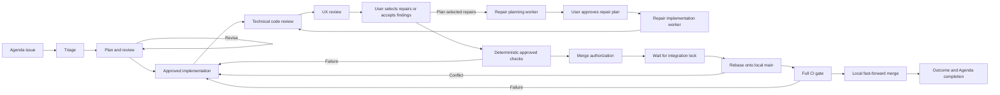

# Local issue lifecycle design and reference

Yinz uses Agenda for requirements, Swamp for durable lifecycle state and evidence,
and Git worktrees for local implementation and merging. Agent work runs in visible
Yinz panes through `@yinz/agent`. Typed behavior methods own state, workflow DAGs
orchestrate repeatable actions, and workers supply reviewed evidence.

The [lifecycle skill](../.agents/skills/issue-lifecycle/SKILL.md) owns normal
operator instructions and resume routing. Read its
[recovery reference](../.agents/skills/issue-lifecycle/references/recovery.md)
only when the driver reports a blocker. This document describes identity,
contracts, persistence and validation boundaries; the
[rule map](../.agents/skills/issue-lifecycle/references/rule-map.md) traces the
instruction reorganization against its baseline.



## Ownership

| Record | Owner | Purpose |
| --- | --- | --- |
| Workspace and item ID | Agenda | Stable issue identity. |
| Item title and note | Agenda | Problem, requirements and acceptance criteria. |
| Plan, review and authorization | Swamp | Versioned evidence for proceeding. |
| Agent task and submission | Swamp and Yinz | Visible worker, provider conversation and exact prompt outcome. |
| State and events | Swamp | Resume point and transition history. |
| Source branch and worktree | Git | Implementation and isolated build artifacts. |
| Gate and merge receipt | Swamp and Git | What was checked and which local commit landed. |
| Delivered outcome | Agenda and Swamp | Whether the issue was resolved. |

Agenda descriptions remain human issue descriptions, rather than generated logs.
Issue capture uses an existing task where possible, searches before creating a
duplicate, and gives a new task a concise title and a note with the problem,
acceptance criteria and useful reproduction details. Project categories may be
reused by returned ID; automation has no dependency on fixed category IDs.

Operator actions (approval, worktree preparation, merge authorization and
close-out) belong to the controlling workflow. Direct `triage`, `plan`,
`review-plan`, `review-code` and `review-ux` methods record evidence; they do not replace pane
workers. Neither input objects nor worker claims establish human authorization.
Existing authorization remains valid within its actual scope. Implementation
approval, merge authorization and a CI waiver are separate decisions.

## One control checkout

The canonical control checkout contains `.swamp.yaml`, local behavior code and
workflow definitions. All Swamp commands and storage use it, including commands
invoked from issue worktrees. Separate per-worktree stores would split history
and per-issue locking.

The [launcher](../scripts/issue-lifecycle) defaults to the checkout containing
itself; its absolute path or `--control` selects that checkout from elsewhere.
Behavior identity derives from workspace and item ID, hashing long workspace
names to fit Swamp's 64-character limit. Names are computed by the launcher.
Direct Swamp calls require `--repo-dir` naming the same control checkout.

### Workspace configuration and prerequisites

The control checkout's `default` vault stores `AGENDA_WORKSPACE`. Its checked-in
vault definition uses `local_encryption`; a missing definition can be created
with `swamp vault create local_encryption default --repo-dir <control> --json`.
The existing workspace value is stored with `swamp vault put default
AGENDA_WORKSPACE --repo-dir <control>` (stdin supplies the value). Values and
keys live in ignored local Swamp storage and need configuration in a fresh clone.
The workspace is a public identifier, visible in identity, state and events.

Every launcher operation reads this value, with no Agenda-current-selection or
missing/invalid-value fallback. `--workspace` only asserts equality, never
overrides it. Lifecycle methods, including direct workflow execution, verify it
against the issue workspace; integration checks before rebase and before merge.
Changing the setting does not migrate issues. A shell `AGENDA_WORKSPACE` variable
is only for manual Agenda commands after setup. Workspace identity and the item
are available through `agenda --workspace <workspace> --json info` and
`agenda --workspace <workspace> --json item show <id>`; configured workspace and
returned item ID identify the issue.

Installed Swamp loads `@yinz/issue-lifecycle` and `@yinz/agent`. Python 3.11+,
Agenda and Git must be on `PATH`; verification needs normal Yinz build
prerequisites. Pane tasks need installed `yinz`, a running local session and the
selected provider. With a saved worker choice, `drive` infers the session from
the controlling pane; outside that environment supply `agent.session` and control
identity. Legacy issues still need explicit provider settings. Installed command help defines unfamiliar flags;
JSON is the machine-read format. Input evidence files are issue-scoped to prevent
concurrent overwrites; paths and text are arguments, never issue text interpolated
into shell programs.

### Worker identity and claims

`start` uses the invoking Git worktree root, including invocation from a
subdirectory. `yinz-issue-start` passes and records canonical `workerWorktree`;
direct workflow calls must supply it too. Before state is saved, the issue claims
the worktree in `<git-common-dir>/yinz-lifecycle/worktree-owners.json`. A worktree
on `main`, detached HEAD, or a worktree/branch claimed by another issue is refused.

A claim is pending until state is saved, then permanent: one worktree serves one
issue. Another issue's `start` reclaims a pending claim only when the original
start is no longer running. A same-issue retry replaces its own pending claim
elsewhere. Repeated `start` returns existing state unchanged and confirms a
leftover pending claim. Later invocation directories do not change worker origin.

Every new role, revision, repair, restart and rollback replacement uses that
saved directory. Pending tasks retain their original configuration. `implement`
adopts the recorded worktree and existing feature branch, rejecting a conflicting
path before Git preparation and upgrading the start claim to worktree/branch
ownership. Branch, approval and merge checks still apply. Legacy states without
`workerWorktree` keep implementation-worktree selection when present, otherwise
the control checkout; legacy preparation may create or adopt a worktree. Resume
and repeated `start` do not invent an origin.

Local `main` must be checked out in exactly one clean worktree; the issue uses a
different local branch in the same repository. Worker origin is spawn-directory
selection. The earlier [execution-boundary experiment](plans/issue-26-checkout-boundary-proof.md)
is superseded historical research, not a gate.

### Worker defaults and issue overrides

Optionally create `.yinz/issue-lifecycle.json` in the canonical control checkout:

```json
{
  "agent": {"kind": "codex", "model": "your-model", "effort": "your-effort"}
}
```

Supported kinds are `claude`, `codex`, `muse`, `pi` and `agy`. Model and effort
are provider-defined strings; omit them for provider defaults. Unknown fields,
unsupported kinds, empty strings and malformed configuration are errors. The
launcher reads this file only for `start`, always from `--control`, even when
invoked in another worktree.

`start --input-file` accepts an optional `agent` override. For example, save
`{"agent": {"effort": "your-effort"}}` in an issue-scoped JSON file to change only
effort. `{"agent": {"kind": "claude"}}` changes provider and clears inherited
model and effort; supply either field explicitly to select it for the new
provider. `{"agent": {"model": null, "effort": null}}` clears both to provider
defaults while keeping the configured kind. Without configuration, supply a
kind in the start override or retain the existing explicit-agent flow.

The resolved choice is saved as `state.workerAgent` with initial state creation,
before the worktree claim is confirmed. Repeated or interrupted starts retain
that original selection. Configuration changes apply to newly started issues.
Status JSON and readable handoffs show the saved choice. Direct start workflow
calls accept an already resolved `agent` object; they do not read the launcher
configuration or apply partial overrides.

Start captures the choice without launching triage. In a controlling Yinz pane:

```sh
scripts/issue-lifecycle --control <control> --item <id> start --input-file /tmp/issue-<id>-start.json
scripts/issue-lifecycle --control <control> --item <id> drive
# Later resumes use the saved choice and identity.
scripts/issue-lifecycle --control <control> --item <id> drive
```

Outside a pane, use `drive --input-file /tmp/issue-<id>-drive.json` with
`{"agent": {"session": "development"}, "control": {"session": "development", "paneId": "terminal_7"}}`.
Launch options such as `permissionMode` and timeouts may accompany the session.
An explicit `drive.agent.kind` retains the existing replacement behavior: supply
the desired model and effort there or omit them for provider defaults. The driver
persists explicit settings for future workers without changing `state.workerAgent`.
Pending workers and saved revision assignments always retain their original
configuration. Legacy states without a saved choice still require explicit
`drive.agent` provider settings; no model or effort is hardcoded.

## Stages and evidence

`@yinz/issue-lifecycle` implements the lifecycle. Entry workflows are
`yinz-issue-start`, `yinz-issue-drive`, `yinz-issue-verify` and `yinz-issue-merge`.
State phases are `triaging`, `classified`, `planning`, `approved`, `implementing`,
`ready`, `merged` and `done`. The skill routes phases using current evidence and
pending work, rather than treating a phase alone as permission to advance.

The repository skill at
[`.agents/skills/issue-lifecycle/SKILL.md`](../.agents/skills/issue-lifecycle/SKILL.md)
drives the lifecycle. Use `drive` for ordinary start/resume flows and after
restart or rollback recovery. Each task runs in a visible Yinz pane and
submits role-specific evidence directly to its assigned `@yinz/issue-evidence`
behavior. Swamp validates and durably acknowledges the submission before the
worker finishes. Final chat text is presentation and is never imported as evidence. The controller
records human authorization and performs deterministic lifecycle operations; it
does not replace pane workers with headless agents or inline agent work.

`drive` runs in the foreground to a concrete handoff or blocker. The launcher
prints readable evidence to stderr and one handoff JSON object to stdout; the
behavior also logs the readable result and publishes `handoff`. Its fields
include identity/status, issue snapshot, plan version or commit, assignment and
recovery identity, decision and presentation. Decisions are
`authorize_plan_revision`, `approve_plan`, `prepare_worktree`, `authorize_merge`,
`integrate`, `summarize`, `complete` and `blocked`. Completed handoffs keep their
identity across resume; changed state or assignments invalidate them.

The driver supplies role-specific prompts and validates results against the
original task and current issue, plan and commit before import. Implementation
returns the clean worktree's full committed HEAD. Reviews contain actual evidence.
`implement`, `review_code`, `review_ux`, `plan_review_fixes` and
`implement_review_fixes` roles require current-plan approval and preparation.
A completed provider turn alone does not establish code correctness.

### Planning generations and adjudication

Initial triage, planning and review are automatic. One targeted revision and
review is available per requirements generation, atomically reserved with its
complete assignment before launch. Resume, rollback, restart, manual planning
and reinvocation do not replenish it. Only refresh with genuinely changed
requirements begins a new generation with initial planning and one automatic
revision; plan versions remain monotonic.

After that allowance, unresolved high/critical findings produce
`authorize_plan_revision` with the current plan, original review, effective
findings, history, revision responses and proposed next version. Repeated drive
calls reuse the handoff without launching workers. Explicit authorization binds
one additional targeted revision to the exact current handoff and actual user
request. Authorization and complete assignment are saved together before
launch; resume reuses it and reviews the result. State, assignment or requirements
changes invalidate proposals. Blank requests and other handoff types are rejected.
Restart instructions reach replacement workers; accumulated feedback survives.

Controller dispositions are stored separately from the original review and apply
only to the matching plan and review fingerprint. That fingerprint fences plan,
review and requirements-generation changes. Stale adjudication and mutations
during unresolved workers or saved reservations are rejected. Rollback retaining
a review retains its applicable dispositions; removed or changed reviews cannot
use them. Supported dispositions require source inspection and an explained
judgment. Accepting unresolved high/critical risk is user direction and remains
blocked, rather than becoming a resolution.

Optional `planningContext` retains feedback, accepted decisions, earlier
plans/reviews, revision summaries and adjudications. History informs reasoning
but never satisfies current review or approval gates. The authoritative
[planning standards](../.agents/skills/issue-lifecycle/references/planning.md),
[review standards](../.agents/skills/issue-lifecycle/references/review.md) and
[Yinz review dimensions](../.agents/skills/issue-lifecycle/references/dimensions.md)
define worker obligations, response/reopening evidence and existing-field citation
conventions.

Existing records need no bulk rewrite: new fields are optional, and saved prompts
and snapshots are kept. Already-applied lifecycle state stays historical evidence.
Unresolved older assignments need a typed submission supplement from their original
worker through `continue-agent`; their final messages are never imported. A legacy
`applying` task with a saved state-changing `next` projection can reconcile directly.
Legacy implementation-only reports need a typed supplement because their commit
binding was formerly stored only in chat. An unavailable original conversation
blocks supplementation and never automatically launches another investigation. Legacy
plans beyond version one are treated as having used the allowance; legacy
first-version plans may receive one automatic revision. Already-recorded revision
authorizations remain usable.


## Pane tasks

The launcher captures control `YINZ_SESSION_NAME` and `YINZ_PANE_ID` for `drive`,
`agent` and `restart-agent`. Stored identity is `control: {session, paneId}`.
Each new worker queries that pane's current tab immediately before spawning with
`--stack-for <control-pane>`. Across issues, workers join a separate tiled stack
owned by that controller; revisions, repairs and restarts follow the control
pane's current tab. Existing workers stay in their tabs. Stack spawning preserves
keyboard focus.

Direct lifecycle callers must supply control identity. `drive` accepts it
alongside `agent`, including adding identity to an older driver without replacing
provider settings. Outside a pane environment, saved or explicit identity is
used. Missing panes, lookup failure or session mismatch block new launches;
there is no automatic-placement fallback. Existing tasks retain original
configuration, and unlaunched legacy tasks require explicit restart.

Agent inputs are `role`, `session`, `kind`, optional `model`, `effort`,
`permissionMode`, `startupTimeoutSeconds` and `timeoutSeconds`. Kinds are `claude`,
`codex`, `muse`, `pi` and `agy`; default startup timeout is 120 seconds and each
task observation defaults to 600 seconds. Omitted optional values preserve
provider defaults; no automatic permission bypass is selected.

Codex, Muse and AGY preflight checks require current fully wired hooks via
`yinz hooks status --agent KIND`. Hooks are not auto-installed. Guarded-prompt
readiness precedes prompting and the provider conversation is pinned; fresh Muse
binds on its first prompt. Dialog interaction is deliberate.

The controller saves the task before dispatch; the reusable behavior saves launch
intent before spawn and unique submission ID before prompt. Unresolved tasks
exclude mutations and second workers. Background work requires a further
observation of the same conversation's final idle answer before success. Accepted
evidence and completion precede guarded pane cleanup. Cleanup retries separately
without evidence replay. Failed, blocked, superseded and unusable-result panes
remain visible; closing the last worker releases the region. Existing tasks keep
legacy placement/cleanup behavior. Conditional recovery procedures and structured
`prompt_delivery`/discard semantics live in the recovery reference.

### Rollback persistence

Rollback records intent before changing Agenda, state or assignments. It archives
prior state, failures, partial imports and assignments and fences old evidence
with a new `rollbackId`, even at the same phase. Evidence before the selected
step and its prerequisites are retained; downstream decisions are invalidated.
Plan versions increase, completed Agenda tasks reopen with descriptions
preserved, and Git changes, ownership, worktrees and branches survive.

A landed merge is not undone: rollback checks durable receipts under the Git
merge lock, and merge/close-out retries reuse them. Earlier-step rollback starts
new review/authorization for subsequent changes. Superseding an assignment does
not stop its processes. Recovery is durable under `recovery`, historical
`recovery-<id>` and `agent-task-<id>` resources; a new explicit rollback may
supersede pending intent while retaining it in history. The skill and blocker
reference own commands and reconciliation procedures.

The reusable behavior saves a versioned launch ID and server incarnation before spawning. A launching resume uses `yinz agent launch-status SAVED_ID --json`; it never issues another spawn. Pending, unknown, mismatched and closed receipts remain blocked. Definitive version-two launch receipts with completed cleanup support deliberate discard even when Git resources remain. Legacy ID-less launches remain uncertain.

## Structured evidence and operator inputs

Inputs are JSON objects for the selected command. Worker outputs are supplied by
pane roles; `status` supplies current versions and recorded commits. Commit
identifiers are full issue-worktree Git IDs, never branch names or abbreviations.

| Contract | Fields |
| --- | --- |
| Triage result | `classification`: `bug`, `feature`, `maintenance` or `security`; `summary`: investigation and acceptance criteria. |
| Plan result | `summary`; nonempty `steps` with unique `id`, `description` (including risks) and `files`; `testingStrategy`; nonempty `checks`; optional `assumptions`. Revisions add `revision`: `summary`, `responses` (`findingId`, `status`, `rationale`, nonempty `evidence`) and `acceptedDecisions`. Response status is `addressed`, `disputed` or `unresolved`. |
| Plan review result | `planVersion`; `findings` with unique `id`, `severity`, `description`, optional `resolution`. Blockers require `requirement`, `mechanism`, nonempty source `evidence`; reopening requires `reopening: {rationale, evidence}` with new evidence. |
| `adjudicate-plan` | Current `planVersion`, `reviewFingerprint`, nonempty `dispositions`: `findingId`, `disposition` (`resolved`, `rejected`, `downgraded`), `rationale`, nonempty `evidence`; lower corrected `severity` required only for downgrade. |
| `approve` | `planVersion`; `request`: actual user authorization and scope. |
| `implement` | Recorded absolute `worktree`, existing feature `branch`; matching worktree is adopted. |
| Implementation result | `summary`; full `commit` of clean issue worktree. |
| Code review result | `planVersion`, `commit`, `steps` covering plan step IDs with `implemented` or `deviated` status; deviations require `justification`; `findings`; optional advisory `preliminaryChecks`. |
| UX review result (`review-ux`) | `planVersion`, full `commit`, `assessment: {impact: material\|no_material_impact, summary, assessedPaths, limitations}`, shared `findings`, optional advisory `preliminaryChecks`. Rationale and assessed paths are nonempty even for no material impact. |
| `decide-review` | Current findings handoff `id`, `reviewFingerprint` from its `codeReviewFingerprint`, actual user `request`, `repair` and `ignore` arrays of `{role: review_code\|review_ux, findingId}`. Role qualifies IDs shared across reviews. |
| Repair plan result (`plan_review_fixes`) | Same checked plan content as an initial plan; selected findings only. Stored separately from the approved issue plan. |
| `approve-review-fixes` | Repair selection `id`, current approval `handoffId`, actual user `request`. |
| Repair implementation result (`implement_review_fixes`) | `summary`, full clean worktree `commit`. Requires the selected repair plan's approval. |
| `verify` | No input; approved issue and completed repair checks run at the reviewed commit through `yinz-issue-verify`. |
| `ready` | `commit`; `mergeRequest`: user authorization to merge, accepting remaining findings at this commit. |
| `merge` | Normally no input; explicit exception is `skipCiRequest`. |
| `repair` | `reason`: failure and repair. |
| `summarize` | `outcomeMet: true`; `summary`: original problem, delivered outcome and limits. |

Finding severities are `low`, `medium`, `high`, `critical`. Unresolved high/critical
plan findings block planning approval. Implementation review findings of every
severity require user direction; users may accept any of them for merge. Empty findings mean a real review found none, never skipped
review. New plan versions require fresh review, as do repaired implementations.
Adopting ad-hoc work does not bypass planning, review or verification.
Requirement changes invalidate affected planning evidence through refresh;
approach changes require plan revision.

Each plan check has a unique `id` (lowercase letters, digits, `-`, `_`, at most
48 characters), `command` argv array and `covers` naming plan step IDs. Commands
run verbatim without a shell, for example
`["cargo", "x", "test", "-p", "yinz-server", "-E", "test(/^tabs::/)"]`.
Checks are focused according to `AGENTS.md`, not unfiltered full suites already
covered by the merge gate. Reviewer preliminary checks contain `command`,
`result` (`passed`, `failed`, `skipped`) and `summary`; they are advisory for
plans with checks. Approval of the presented plan approves running its checks.

### Separate implementation reviews

Normal drive runs implement -> technical code review -> UX review -> user
findings decision (when findings remain) -> approved checks -> merge authorization. Both visible workers review the same full commit,
issue requirements and current approved plan. Technical review independently
challenges behavior and design assumptions, traces affected callers and lifecycle
paths, and inspects weak assertions while reporting every plan step. UX review
traces affected users/tasks through discovery, normal/repeat use, waiting,
failure, cancellation and recovery, including indirect usability effects.
Both read the shared evidence/severity standards and applicable review dimensions.

`state.uxReview` is optional historical storage, never defaulted to completion.
Status and handoffs show its impact, rationale, assessed workflows/source paths,
limitations, findings and actual advisory checks alongside technical findings,
step coverage and lifecycle verification. Empty findings and supported no-impact
assessments are valid; no UI-file change alone is not a rationale. Proposed fixes
must not be marked as resolutions of newly reported defects.

Verification preflight, `ready`, `begin_merge` and resumed unlanded integration
require both current reviews. Verification and integration also require recorded
user acceptance of outstanding findings. `ready` can record that acceptance
through explicit merge sign-off. Technical approval never substitutes for UX. New technical evidence or a repaired commit
invalidates UX and downstream evidence. UX-only rollback retains matching
technical review/head but clears UX, verification and authorization. Ready-only
rollback retains both reviews and same-commit verification. Saved original tasks,
prompts, submissions and accepted receipts resume without duplicate reviewers.

The `address_review_findings` handoff presents both reviews and asks which findings
to address. No automatic code repair is allowed. Selection authorizes only a
`plan_review_fixes` worker. Its proposed changes, risks, assumptions and argv
checks yield `approve_review_fixes`; explicit approval authorizes an
`implement_review_fixes` worker in the existing worktree. Repairs preserve the
original approved plan and require fresh technical and UX reviews. New findings
or changed review evidence return to the user instead of extending approval.

Optional `reviewDecisions` retains selections, actual requests, source reviews,
repair plans, approvals and committed results. Decisions bind requirements,
rollback, plan and both exact reviews through `codeReviewFingerprint`. Stale
handoffs, reused IDs with different input and unknown/duplicate finding references
are rejected. Ignored findings keep their original severity and unresolved
status. Unselected findings remain pending. Merge sign-off can accept all
remaining findings; when checks have not run, record that acceptance with
`decide-review`, run checks, then record `ready` using the already-given merge
request. Acceptance never waives verification or the separate full merge CI gate.
Completed repair checks are added to original checks with unique lifecycle log
IDs; repair-plan approval authorizes them. No additional approval is needed to
resume the same saved worker assignment. Explicit repair-worker restart preserves
selected scope and existing implementation approval while fencing the old worker.
Ordinary rollback requires renewed decisions for retained findings.

Existing records need no bulk rewrite. Legacy unmerged findings reach the new
handoff without inferred acceptance. Already-landed receipts remain authoritative.

Legacy pending tasks finish under their saved contract and never count as UX.
Legacy implementing work with current technical review proceeds to UX. An
unmerged ready state without UX blocks with rollback-to-review_ux/drive guidance
and requires checks and new merge authorization; an unlanded active attempt
requires repair and fresh reviews. Integration first reconciles durable landed
receipts; landed merges and merge/close-out rollback/replay do not require
retrospective review or fabricated evidence. See [recovery](../.agents/skills/issue-lifecycle/references/recovery.md).

The [bounded reviewer evaluation](../.agents/skills/issue-lifecycle/references/review-evaluation.md)
records actual planted-defect and no-impact outcomes separately from lifecycle
approval. Prompt assertions test the assignment contract, not review quality.

## Reusable Swamp extension

[`extensions/yinz-agents.yaml`](../extensions/yinz-agents.yaml) packages the
`@yinz/agent` behavior and `yinz-agent-task` workflow independently of Agenda or
this issue lifecycle. The behavior methods include `run {prompt}`, `resume {}`, `status {}` and
`continue {id, prompt}`. Completion here means a correlated provider turn ended
with no background work; presentation text is optional. Only the lifecycle can
classify accepted evidence as a completed lifecycle task. Global arguments are `session`, `kind`, absolute `cwd`, and the
optional model, effort, permission and timeout settings described above. Omitted
or empty optional model, effort and permission strings preserve provider
defaults. Standalone behavior callers may optionally pass
`control: {session, paneId}` to use the same tab resolution; lifecycle workers
require it. A behavior represents one original task; use a new behavior name for a new task.
`continue` is for a retained conversation, including a submission-only supplement.
Its ID and prompt are durable before delivery; identical calls retrieve that
continuation rather than sending again. Original configuration, prompt and digest
remain bound, and previous terminal turn snapshots are retained. Repeating `run` is refused, even with the same prompt. After
submission, `resume` observes its saved ID rather than sending again. It can
observe the exact saved launch before submission. A verified matching started
receipt continues that original task; definitive terminal non-execution/exit
receipts are saved as `launch_rejected`. Resume explains deliberate lifecycle
controls for those original assignments. Unknown and legacy launching tasks
remain blocked. Launch receipts do not replace task/prompt/approval,
conversation, submission, or evidence-import guards.

The workflow input shape is:

```json
{
  "agentName": "review-example-1",
  "agent": {
    "session": "your-running-session",
    "kind": "claude",
    "cwd": "/absolute/path/to/existing-worktree"
  },
  "prompt": "Review committed changes against local main. Do not edit. Report findings."
}
```

Installed commands are `swamp workflow validate yinz-agent-task`,
`swamp workflow run yinz-agent-task --stdin`, and `swamp behavior run <agentName>
resume|status`, all with `--repo-dir <control>`; machine reads use `--json`.
`result` is published only for a correlated completed provider turn with no
background work; final presentation text is optional. `state` retains launch, pane, conversation and
submission identity; `observation` stores live status separately. Completion is
an answer, not correctness evidence replacing lifecycle review/verification.

## Deterministic verification

After current technical code review, separate UX review and user findings decisions, `drive` (or explicit `verify`) runs the approved plan's
checks in order outside the repository merge lock. Before each check, the Git
helper requires a clean issue branch at the reviewed commit with its own real
`target/`. Each check records exit code, duration and output.

A check that dirties the worktree, changes branch/HEAD or is refused by the helper
fails with a reason; later checks are not run because they would test a different
tree. Other failures do not prevent later checks. After each check the helper
kills remaining processes in its process group so background children cannot
hold logs open. At one hour, a running check and its group are stopped and the
check fails as timed out with no exit code; later checks still run.

`verification` binds the run to plan version, branch and commit. Output resources
are `check-log-<verification id>-<check id>` of type `check-log`, retrievable with
`swamp data query 'modelName == "<issue behavior>" && name == "check-log-<id>-<check>"'
--select content --repo-dir <control>`. The checklist supplies the actual query,
including any hashed behavior identity.

`ready` requires passing verification of the reviewed commit and current plan.
New plan, worktree adoption, technical or UX review, repair, refresh or rollback to
`review_ux` or earlier discards verification. Rollback of only `ready` retains
verification for an unchanged commit. Failed runs block and are not automatically
rerun by `drive`; environment-only explicit reruns and repair procedures are in
the recovery reference. Every run remains in event history. The launcher prints
the checklist on stderr and JSON on stdout, exiting 2 on failure.

Legacy plans without `checks` still require both current reviews and retain the
reviewer-reported gate: `ready` rejects failed preliminary checks from either
reviewer. Approved repair checks augment this gate; they never discard failed
preliminary checks. Without repair checks, the handoff states no deterministic
verification ran. New plans/revisions require checks. Empty or cancelled checks are not success.

## Development checks and the merge gate

Development uses targeted tests covering changed behavior and affected callers,
with the command, result and coverage rationale recorded. Failures and flakes
are defects fixed in the current branch; a passing rerun alone does not resolve
them. Each worktree has its own real `target/`: no `CARGO_TARGET_DIR`, changed
`build.target-dir`, shared targets, symlinked targets, hardlinked mutable artifacts
or copying mutable build artifacts/binaries/metadata between worktrees. The
worktree's own binary is built before tests that use it.

The merge gate is `cargo x ci check` after rebase onto current local `main`:
format checking, lint, tests and integration tests. Docker suites are separate;
relevant remote tests accompany changed remote behavior. Only an explicit user
request for that merge permits `skipCiRequest`, recording request and scope.
Prior passes, a small diff, expensive builds, time pressure and agent judgment
are not waivers. Skipped CI is recorded as skipped, never passed.

### Merge-gate evidence

Each attempt retains evidence in the shared Git directory:

| Path | Contents |
| --- | --- |
| `yinz-lifecycle/merges/<attemptId>.json` | Receipt with status, commits, CI result and failure. |
| `yinz-lifecycle/merges/<attemptId>/ci-check.log` | Complete CI stdout/stderr, surviving terminal and Swamp output. |

Output streams to the terminal and Swamp `merge-log-<attemptId>`. CI emits
`>> ci phase <name>: passed|failed`. Receipt `ci` records `log`, `exitCode`, only
reported `phases` (missing markers never mean passed), `failedTests` (nextest
failure/timeout/signal lines and failed doctests, at most 50),
`failedTestsTruncated` for the rest, and one-line `summary`. Interruption keeps
partial logs with null exit code.

Each new receipt's `previousAttempts` lists the issue's earlier failed attempts.
State `mergeFailures` survives repair, rollback and eventual merge, exposing the
failed-then-passed sequence. A later pass cannot hide a flake. Failure output and
blocked presentation include phases, failed tests, summary, log and attempt
history. `repair` appends summary/log to `lastFailure` for the next implementation
worker. Retrying does not overwrite evidence.

## Typed evidence submissions

The controller saves the exact task and opens an `issue-evidence-<task UUID>`
Swamp behavior in the canonical control checkout before launching its worker.
The immutable assignment binds the task, role, worker configuration and prompt,
issue requirements generation, lifecycle snapshot and rollback identity, plan
version, and dispatched technical/UX review commit. `status` includes the task's current
submission resource as well as the lifecycle and provider records.

The worker writes a temporary JSON submission file with `taskId`,
`assignmentDigest`, `role` and `evidence`, then runs the supplied commands:

```sh
swamp behavior run "$EVIDENCE_BEHAVIOR" submit \
  --repo-dir "$CONTROL_REPO" --stdin --literal-inputs --json < "$SUBMISSION_FILE"
swamp data query "behavior(\"$EVIDENCE_BEHAVIOR\") && name == \"submission\"" \
  --repo-dir "$CONTROL_REPO" --select content --single --json
```

Use the sanitized local environment in the assignment. `--literal-inputs` keeps
source excerpts literal. The method's strict role schema and semantic validators
run before a single accepted resource is published. Resource schema declarations
alone are insufficient: Swamp's resource writer reports mismatches as warnings.
The short submission method opts into Swamp's `rollbackOnFailure` boundary and
performs no external mutations. Its resource has infinite lifetime and preserves
the accepted evidence and receipt when superseded.

A matching `status: accepted` receipt acknowledges the original task and payload.
An identical replay acknowledges the existing acceptance without rewriting it;
the query returns its original receipt. Different evidence conflicts. Validation errors are returned while the worker is still running and
can correct its submission. If acknowledgement is lost, query this resource
before replaying. Final prose may be arbitrary, truncated or absent. A provider
turn ending without accepted evidence leaves the lifecycle task unresolved.

The controller imports the receipt only after correlated provider completion and
background-work checks, and rechecks current requirements and applicable Git
state. Acceptance and projection are separate durable facts. Import uses a stable
per-task event identity and resumes partial event/state/task writes without
repeating investigation. Later requirements or Git changes can make accepted
historical evidence inapplicable without deleting it.

For a missing submission or legacy supplement, continue the original context:

```sh
"$LIFECYCLE_REPO/scripts/issue-lifecycle" --item "$AGENDA_ITEM_ID" \
  continue-agent --input-file /tmp/continue-submission.json
```

The input contains the original `taskId` and a nonempty `request` to submit the
existing findings. Identical requests reuse their saved continuation. Recovery
checks for already-accepted evidence first. Changed continuation requests can
start another submission-only turn in that same conversation. Missing, cleaned,
active or replaced conversations block; no replacement worker is launched.

Worker authority covers only its assigned `submit` method and receipt query.
Approvals, adjudication, rollback, restart, worktree preparation, merge, CI waivers
and Agenda mutations remain controller operations. Rollback and discard save their
intent and close the evidence behavior before changing parent state. Submission
and closing serialize on that behavior's lock, retaining earlier receipts.

Submission must never acquire the issue OS lock or call a waiting issue/agent
method: the controller holds those locks during provider work. Its separate
behavior lock permits immediate validation without a cycle. Current direct CLI
submission supports healthy local format-2 filesystem datastores. Preflight
rejects solo format-3 and custom backends before dispatch; format-3's command-wide
writer lease requires different orchestration or Swamp server execution before it
can support this waiting pattern. Worker sandboxes need authorized access to the
canonical submission interface; do not bypass permissions or create another store.
Swamp's optional durable-write setting adds filesystem syncing for power-loss
protection; atomic publication already covers process interruption.

## Parallel development and serialized integration

Issues may plan, develop and review independently in isolated worktrees. Swamp
serializes methods per issue. `yinz-issue-merge` uses the shared
`yinz-main-merge` coordinator, which calls the behavior's `integrate` method; an
additional OS lock protects the common Git repository. These are distinct from
per-issue locking.

The repository lock spans rebase, full CI and fast-forward merge. A second issue
waits, then rebases against `main` as it exists on acquisition. Waiting is not
FIFO. Independent Git commands do not participate; manual `main` movement during
integration would bypass protection.

The lifecycle advances local `main` only. Fetch, push, PR creation, remote merge,
deployment and notifications to others are outside its scope and require their
own user instruction. Optional close-out follows successful issue completion;
failed worktrees remain for diagnosis. Completion requires local merge and
`outcomeMet: true`; unmet issues remain open with remaining work recorded.

## Optional resource close-out

After local merge, recorded `outcomeMet: true`, and Agenda completion, `drive`
returns `authorize_closeout` when the targets can be validated. `summarize` also
publishes this offer after saving completion; an unavailable offer reports
completed outcome and retained resources. Completion itself deletes nothing. Present the exact
bundled offer and obtain a separate explicit decision. Plan approval and merge
authorization never authorize deletion. For example:

> Delete `/work/yinz/.worktrees/issue-77` including its build outputs, delete local
> branch `issue-77`, then close the original controller `development/terminal_7`.
> Accepting ends that conversation. Decline retains all resources and the completed
> outcome.

Use the returned handoff ID with the actual user request in an input file:

```json
{"handoffId":"<returned offer ID>","decision":"accept","request":"<actual user authorization>"}
```

```sh
scripts/issue-lifecycle --item 77 closeout --input-file /tmp/issue-77-closeout.json
scripts/issue-lifecycle --item 77 resume-closeout
```

These launcher methods dispatch directly to Swamp's issue behavior (`closeout`
and `resume_closeout`). `decision: "decline"` records retention and ends the
automatic offer for that completion. Omitting a decision creates or presents an
offer; it grants no deletion permission. `status` shows the offer, targets and
results. An initial decline leaves the merged/done outcome and all resources intact.
Renewed offers describe only remaining actions: after Git deletion, decline keeps
the original pane and completed outcome; it cannot restore deleted resources.
Declining partial cleanup stops further effects and preserves saved progress and
any unresolved ownership reservation, without claiming cleanup finished.

The first successfully observed controller binding is stored independently of
later worker placement. An offer pins that session, server incarnation, terminal
pane, provider and conversation. Acceptance samples a fresh fence for the
accepting turn. Recovery never substitutes its invoking pane, an active pane or
a worker. Old states, missing origin records and servers without
`agent-controller-closeout-v1` retain resources with a diagnostic. To explicitly
bind an unavailable legacy origin, inspect the exact intended controller using
`yinz --session development agent closeout-snapshot terminal_7 --json`, then call
`closeout` with `bind: {session, paneId, server_instance, provider, conversation}`.
This creates an offer only; present it before a separate accept/decline request.
An existing qualified original binding cannot be replaced by this operation.
Snapshot refusals retain the server's diagnostic, for example `Controller closeout
would affect other panes`. Resolve that reported condition before requesting an
offer again; a refusal never authorizes a replacement controller.

Before deletion, the behavior checks completed, unchanged Agenda requirements,
the durable local merge receipt, unresolved workers/recovery/reservations, and
known session pane working directories. Unknown or active users of the issue
directory block deletion. The Git helper validates the exact registered linked
worktree, filesystem/registration identities, ownership, clean tracked/untracked
state, unchanged merged HEAD, local-main ancestry and branch checkouts. It
protects control/main/store and containing directories, and refuses locks,
unfinished operations and submodules requiring manual handling.

Closeout validates the recorded merged receipt with the read-only
`closeout-receipt` Git-helper action. It checks issue/attempt identity and local
`main` containment without taking the repository merge lock or reconciling a
receipt. An unreconciled `verified` receipt still needs normal integration recovery
before cleanup. Mandatory integration and pre-completion receipt reconciliation
retain their existing merge-lock wait behavior.

Closeout lock order is issue, then the brief worktree ownership guard; Git also
uses its native locks. Standalone deletion of an already-merged worktree and local
branch does not require the lifecycle merge lock and can complete during another
issue's rebase/CI/merge. The helper reserves ownership with the cleanup UUID,
writes durable intent before each step, removes the worktree with non-force Git
removal, then compare-and-deletes the expected local branch OID. It retains a
helper receipt after releasing the exact ownership entry. Arbitrary manual Git
and external processes do not share the lifecycle guard; uncertain or changed
targets fail closed. No remote Git is used.

Optional close-out attempts the worktree ownership guard without queuing for
preview or cleanup. If that guard is busy, it returns promptly with the blocked
stage, lock and retry action. For example:

> Optional closeout deferred during cleanup preview: worktree ownership lock is
> busy; another lifecycle operation holds the brief worktree ownership guard.
> The completed outcome and recorded cleanup progress are unchanged.
> Let that operation finish, then retry closeout or resume-closeout.

Preview contention creates no new offer or consent. For an already accepted
partial cleanup, a busy result during `Git cleanup` leaves the pane open and keeps
the same cleanup UUID, prior deletions and ownership reservation. It performs no
new cleanup step and does not mean all resources still exist. Inspect the existing
ownership operation, let it finish, then explicitly retry `closeout` or
`resume-closeout`. This brief contention is independent of another issue's merge
CI. Do not cancel another issue's merge gate, remove lock files or delete resources
manually to bypass the guard. Retry still revalidates targets and may require
fresh pane consent.

Git results are saved in Swamp before the final pane-close intent. The server
compares the exact fence and closes within the same screen-thread operation;
it refuses later input/turns, background or additional control work and closes
that would affect another pane. The correlated executing controller turn may
end without becoming idle. The existing completed-worker close guards remain
separate.

A failure can read: `Git closeout failed; pane retained. Use resume-closeout:
Worktree is not clean: /work/yinz/.worktrees/issue-77`. Fix the reported cause,
then resume the saved cleanup. A removed worktree need not be reopened to finish
branch deletion. Recreated paths/branches, changed claims and moved commits block
replay. A pane-close problem never undoes completion or successful Git deletion.

Self-close may terminate the caller before its reply. The saved pane result stays
`unknown` until observation; run `resume-closeout` from another pane. Only absence
of the exact pane in the same server incarnation reconciles as absent. Changed
incarnation/conversation or unobservable state cannot prove success or authorize
closing a replacement. A later turn/input expires the fence, producing a fresh
offer ID; present it and record fresh explicit acceptance or decline for the same
controller. With Git complete, the offer says the worktree and branch are already
removed: accept closes that conversation; decline keeps its pane and makes drive
complete without another offer. Git deletion is retained and not repeated. No
background close job is scheduled.
Rollback/refresh preserve historical cleanup facts while revoking current consent.
After rollback to summarize, record the corrected outcome before recovering a
saved cleanup operation. Re-completion with unchanged requirements, merge attempt
and targets preserves its cleanup UUID and progress, including uncertain helper
results. It offers fresh consent before partial Git cleanup or a pending pane close;
recovery never previews the removed worktree or replaces a reserved operation.
An unknown pane close can still reconcile same-incarnation exact absence without
another close. Confirmed closure remains a fact. Changed requirements, merge
identity or targets block reuse and retain historical progress without granting
new authority. After accepted cleanup, implementation must deliberately select a new
valid worktree; repeated start/status/drive/summarize do not inspect a removed one.

## Validation boundaries

Extension checks live under `extensions/`: `deno task check`, `deno task lint`,
`deno task fmt` and `deno task test`. Focused selection follows `AGENTS.md`;
these are available checks, not an instruction to run unfiltered suites during
development. Root Python test modules are selected separately with
`python3 -m unittest discover -s scripts/issue_lifecycle/unit -p <filename>`:

| Module | Boundary |
| --- | --- |
| `test_git_ops.py` | Local Git locking, ordering and recovery, with fake Cargo gates. |
| `test_workspace.py` | Workspace configuration and identity. |
| `test_swamp_smoke.py` | Installed-command dispatch, Agenda and local merges in disposable repository/data fixtures; requires installed Swamp and Agenda. |

Focused tests cover transitions, role dispatch, revision authorization,
adjudication, human handoffs, timeout observation, interrupted imports, stale
evidence, restart invalidation, Agenda/Yinz adapters and prompt correlation.
Agent tests inject a Yinz runner. The installed-command smoke test checks one
automatic revision, one further revision per explicit authorization, continued
blocker adjudication, separate implementation approval, original-submission timeout
resume and handoff resume without duplicate prompts. It also fails a fake Cargo
merge gate, checks receipt/log/blocked handoff/repair, then both attempts after a
passing merge.

The installed-command smoke test submits evidence from a second process while the
controller waits and drives planning through review with truncated final chat.
It also checks continuation and handoff resume without duplicate submissions,
stale finding selections, acceptance without invented resolutions, repair planning
and approval through the launcher, committed repairs, and fresh reviews/checks.

Fake Cargo checks establish ordering/recovery without running full Rust suites.
They establish neither live provider launch nor a passed full feature gate. A
separate live smoke check exercised installed Swamp through a visible Claude pane
using the earlier final-message transport; it does not establish live-provider
coverage of the typed submission protocol. The
real full gate runs at authorized local merge. No dedicated skill-text smoke test
is defined here.

## Design origin

The source is Swamp's `@swamp/issue-lifecycle` and
`.claude/skills/issue-lifecycle/SKILL.md`, with schemas in
`extensions/models/_lib/schemas.ts` and DAGs under `verification/`.
Swamp's `design/primitives/workflows.md` and `design/primitives/behaviors.md`
explain the primitive boundaries. Yinz preserves typed state methods, DAG
orchestration and agent-supplied reviewed evidence, replacing Swamp Club/GitHub
stages with Agenda identity, local verification and a local merge receipt.
It does not synthesize evidence for ad-hoc work or complete unmet outcomes.


### Qualified completion after closure

Ordinary drive/resume observes the saved submission without repeating implementation.
Claude observation retries initial transcript absence and exact completion delivery
under an absolute deadline and the original process/conversation identity. A
linked answer plus positive registry idle can qualify a screen-thread closure
snapshot, provided no input or activity intervened. Accepted evidence remains
insufficient until execution is positively terminal and quiescent.

Validated passive permission samples from the same process/conversation preserve
an existing completion claim; they never establish completion or quiescence.
A matching normal SessionEnd freezes eligible facts before clearing the live
record. Duplicate shutdown, held exit and pane/tab closure preserve that frozen
proof and its original expiry. An explicit user close, including plugin
`PaneTabs Close`, can remove several related panes; each eligible worker is sampled
before any member is removed. New input, activity or replacement still blocks it.
A positively observed interruption remains retrievable as `interrupted` on the
original submission; it never supplies a successful retained proof or allows
accepted evidence to advance the lifecycle.

The same server retains at most 1024 closed proofs for 24 hours. The child checks
launch incarnation, session, provider, cwd, pane, conversation, submission and
saved turn identity, then saves the proof before publishing its result. Interrupted
publication resumes from that durable proof; normal parent import guards and
stable events still apply. Retained completion does not imply live availability.

Missing/legacy proof, expiry, eviction, restart, replacement, interruption and
unknown/background work remain blocked with their actual diagnostic. Inspect
saved identity and execution facts; do not infer success from receipt acceptance,
elapsed time, absence, raw Stop, end_turn or EOF. Historical #78 facts already
deleted cannot be reconstructed by this path. Restart/rollback and cleanup still
require their existing controller authority; do not repeat finished work merely
to rebuild bookkeeping. See docs/AGENT_CLI.md, “Closed submission reconciliation”,
for the response fields and direct wait syntax.

### Completion recovery and inconsistent run observations

Controller recovery first checks the original child's durable completion when
its typed receipt is already accepted. It validates the same result and receipt
used by ordinary import, including assignment, conversation, submission and
commit freshness. It does not invoke the completed worker again. Interrupted
imports retain their existing event and task reconciliation guards; cleanup
remains separately retryable.

Wait failures carry an optional `failureKind` (`timeout` or `other`). Only a
fresh, correlated timeout with matching available server, turn and directory
identity is eligible for automatic observation. Transport errors cannot reuse a
previous timeout's raw response. Legacy records acquire this classification on
the next observation; elapsed time never determines worker staleness.

The launcher's read-only `status` adds `workerObservation` and `diagnostics` to
its existing JSON response. Diagnostics include reason codes, original worker
identities, exact inconsistent workflow run IDs and recovery actions. A workflow
still recorded running after its issue reaches done is an inconsistent
observation, not proof of a dead controller. Status never cancels, finalizes or
rewrites historical runs, and its observations never authorize evidence import.

## Review continuity and assessment

New worker assignments use `contractVersion: 2` alongside the unchanged submission
protocol. Their optional-on-disk `continuity` context is mandatory for new dispatch
and bound by the assignment digest to task ID, requirements digest/generation,
rollback identity, plan version, current role review fingerprints, packet digest
and captured full Git object IDs. Saved legacy assignments retain their original
schema, prompts and submission supplements. Strong completeness checks apply only
to new assignments; old records are never rewritten or made to reinvestigate.

Before implementation/review dispatch, the Git helper captures local main,
merge-base and reviewed HEAD, complete binary-capable feature diff, optional prior
endpoint delta, ancestry, changed-baseline flag and explicit limitations. UX pins
the technical review's endpoints even if local main moves. Rebased or divergent
history is explicitly labelled; missing prior objects disable delta/reuse
assistance, while missing required current objects block dispatch. Captured diffs
are untruncated, with explicit base64 encoding for non-UTF-8 diff bytes; the saved assignment is authoritative even if named refs move.

`reviewHistory` archives superseded role reviews before ordinary implementation,
plan change, review replacement, requirements refresh and rollback clear them.
Archives retain requirements/generation, rollback, role and fingerprint. A UX-only
rollback archives only UX and retains matching technical evidence. Archives never
satisfy current gates. Concern identity includes issue, role, origin fingerprint
and stable finding ID. Cross-role links preserve independent obligations. The
packet carries complete saved planning/review decisions, user authorizations,
selected findings, repair plans/responses, approved checks and failure log
references; it distinguishes worker-proposed tradeoffs from dispositions and
actual approvals. Changed requirements retain archives as context without
importing their old obligations into the new digest.

Repair planners map every selected full finding identity to repair steps and
checks. Implementers respond to every selection with `addressed`, `disputed` or
`unresolved`, rationale, affected paths and source/check evidence. A new scope
proposal returns through repair planning/approval. Implementation claims never
close findings. Subsequent reviewers respond to prior unresolved findings with
`persists`, `verified_fixed` or `reopened`. Persistent concerns remain in current
findings with their original identity. Omission cannot close a concern. Reopening
verified-fixed concerns requires new evidence and rationale addressing the earlier
decision. An unchanged ignored concern is labelled historical continuity and
remains unresolved; acceptance still needs an exact current review fingerprint.

Requirements review remains independent of the approved design. Full feature
scope, assumptions, callers, tests and failure paths remain review obligations;
the repair delta only prioritizes investigation. Technical and UX reviews remain
sequential and fresh after repairs. Selection, repair-plan approval, current
finding acceptance, deterministic verification and merge authorization remain
separate gates. Rebased merge CI and its explicit per-merge waiver rules are
unchanged.

Optional structured `advisoryEvidence` preserves producing task, original commit,
requirements, argv/cwd, result, durable output reference, dependency files/tests,
platform/toolchain and environmental prerequisites. Reuse retains original
attribution, names the current commit and explains applicability. Changed commits
need a comparison of implementation, callers, tests, fixtures, dependencies,
build configuration, requirements and environment. Missing evidence/objects,
unknown scope, dirty execution or failed/flaky results cannot justify passing
reuse. Original provenance must match retained evidence. Availability and
comparison declarations are worker evidence assessed by reviewers, not a claim
that schema validation independently proves dependency equivalence. Existing
free-text preliminary checks remain advisory. Neither form can supply a lifecycle
verification receipt or bypass rebased merge CI.

`rounds` is an append-only journal keyed by assignment ID, recorded at reservation
and idempotently reused on resume. The original round is bound inside the saved
assignment, including a driver reservation that has not dispatched. The separate
journal reconciles that record after task publication, so interrupted reservation
writes do not create phantom rounds. Each record links its predecessor and stores
launch causes separately from later evidence-backed classifications/corrections.
Supported causes are initial work, newly discovered defect, incomplete repair,
changed requirements, verification/merge failure, recovery, explained other and
unknown. Review evidence can establish an incomplete repair or new discovery; it
cannot establish that a repair introduced a defect without comparison evidence.
Recovery facts are consumed without changing stale-run detection, completion
recovery or worker terminality requirements.

The read-only report at `scripts/issue_lifecycle/continuity_report.py` consumes
exported records and never connects to Swamp, Git or Agenda. It deduplicates
assignment IDs, retains unknown historical causes, separates launch attribution
from review observations, and reports per-issue rounds, elapsed span, first-repair
closure, incomplete-repair evidence, unsupported reopening, requirement coverage,
advisory executions claimed avoided, gate defects and recorded later regressions.
Evidence-backed quality annotations require both `source` and `evidence`; absent
annotations remain unknown rather than becoming zero. Findings persisting after
repair indicate incomplete closure, not proven introduction by that repair.
Only corrections with an explicit `replaces` index update a launch cause, in
journal order; observations leave unknown launch causes unknown. Repair outcomes
use the first eligible review per role whose assignment snapshot already contains
the completed repair decision and whose reviewed commit matches its result.

The frozen pre-change sample and source/version projection references are under
`docs/evaluations/lifecycle-continuity/`. It contains all 16 completed issues
available at capture, 231 distinct observed assignments; historical causes and
first-repair closure are unassessable where their original records lack them.
Its median observed elapsed span is 12,444,562.5 ms; this includes user waits and
recovery and is not active work time. The next 20 distinct completed issues with
at least one new-contract assignment and completion after the frozen timestamp
form the pilot. No future completions are manufactured or lifecycle workers run
to populate it.

```sh
python scripts/issue_lifecycle/continuity_report.py --normalize /tmp/export.json > /tmp/pilot.json
python scripts/issue_lifecycle/continuity_report.py \
  --baseline docs/evaluations/lifecycle-continuity/pre-change-sample.json.gz \
  --pilot /tmp/pilot.json
```

An export has `{results, limited:false}` with each record's `modelName`, `name`,
`specName`, `version`, `createdAt` and parsed `content`. Include all relevant
historical state, agent-task, rounds, driver reservations and recovery versions; paginate or query per
issue to avoid oversized output. Project task content to ID, role, createdAt,
contractVersion, round, before.issue.digest/rollbackId, before.reviewDecisions
(including each decision's ID and result) and evidence (acceptedAt, payload,
payloadDigest); project state to issue digest, phase, receipt, reviewDecisions,
mergeFailures and verification. Normalization omits prompts/prose while retaining
source-version projection digests. The normalized format has schemaVersion,
frozenAt, sourceDigest, timingLimitations and issues; callers may append attributed
quality observations without changing the frozen baseline. Gzip exports are
accepted. Preserve additional timing-map limitations in `timingLimitations`.
Schema version 1 adds `completedRepairDecisionIds` to normalized reviewer
assignments. Older normalized exports remain readable; repair closure stays
unknown when this snapshot correlation is absent.

Comparison stratifies by changed requirements, recovery and gate failures. A
claimed benefit requires less repeated investigation/repair at comparable scope
with no observed reduction in defect detection or safeguard compliance. Report
small-sample uncertainty, missing attribution/follow-up and quality regressions.
The report deliberately makes no automatic improvement claim. Bounded paired
reviewer conversations and their limitations are recorded in the review evaluation
guide; passing contract tests alone are not review-quality evidence.
